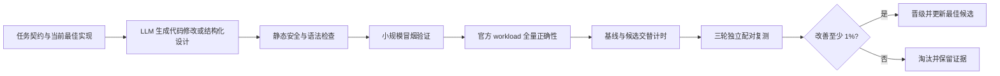

# GPGPU 算子自动优化

本项目构建并验证了一套面向 GPU 算子的自动优化闭环：**大模型生成 Triton 内核修改，系统自动
完成静态检查、正确性验证、真实性能测试和候选晋级**。当前已在 NVIDIA V100 32GB 上完成 KDA
（Kernel Design Agents）工作流适配，并产生首个经过三轮复测后稳定晋级的优化候选。

> 当前成果的核心关键词是 **自动化算子优化**。Poly 调度和 Halide IR 规范化仍是后续接入方向，
> 目前没有将参数搜索或 Triton 源码处理包装成已完成的 Poly/Halide 成果。

## KernelWiki 天数 BI-V150 适配

**技术简报｜工作范围：2026年9月30日至10月11日｜整理日期：2026年10月13日**

### 总体成果

本项目将 KernelWiki 中的 GPU 优化知识扩充到天数智芯 BI-V150，并接入 KDA（Kernel Design Agents，算子优化智能体）流程。原有 NVIDIA Hopper／Blackwell 内容及其适用范围保留，天数平台新增独立的工具链说明、算子案例和实验依据。

目前已打通“**读取知识 → 生成候选 → 正确性检查 → 训练测速 → 记录结果**”的流程。在已验收的代表性 BF16 模拟训练模型中，组合优化相对同卡原生 Megatron 后端的吞吐提升为 **8.13%、9.34% 和13.96%**。

### 完成了哪些工作

- **知识迁移：** 增加 BI-V150 架构检索和17项迁移记录，区分已验证方法与待验证能力；当前可精确检索38条天数相关路径。
- **算子与训练验证：** 使用 Claude Code CLI 和项目级 skill 迭代候选，开展交叉熵、梯度范数、RMSNorm、Dense SwiGLU、Attention、MoE带权SwiGLU六类实验，并接入 Megatron 正式训练入口。
- **可复现交付：** 适配版可从仓库重建并由 KDA 项目目录加载；Linux CI完成构建、校验、加载及记录复核，162项知识库测试和8项新增门禁测试通过。

### 算子与实现方式

目标算子来自 Megatron 的实际训练调用。Triton 是部分候选的实现工具；各训练配置采用不同的算子组合。下表列出已验证的实现方式，GEMM／GroupedGEMM的训练热点优化仍为下一步工作。

| 算子或训练热点 | 已验证的优化方式 |
|---|---|
| 交叉熵（CE） | BF16方案保留原生前向，采用Triton反向融合 |
| 全局梯度范数 | 保留原生PyTorch范数计算，合并GPU到CPU的标量传输 |
| RMSNorm | C++/CUDA局部点运算融合，保留原生归约和梯度图 |
| Dense SwiGLU | Triton前后向点运算与已编译启动入口复用 |
| Attention | TorchScript减少调用开销，复用原生CUDA融合softmax和矩阵乘法；尚未重写FlashAttention |
| MoE带权SwiGLU | Triton前后向与路由权重梯度计算，复用已编译入口；专家矩阵乘法保持原生 |

### 直观的性能提升

下表的GPT／MoE是训练验证场景，算子组合见上文。它比较同一张 BI-V150、同一模型与精度的**原生后端和组合优化版本**。计时覆盖训练步骤的前向、反向和SGD更新，排除启动、checkpoint保存与评估。

| 已验收的训练配置 | 原生耗时 | 优化后耗时 | 训练吞吐提升 |
|---|---:|---:|---:|
| 4层MoE，4专家、序列256 | 76.20–77.48毫秒/步 | 70.57–71.09毫秒/步 | **8.13%** |
| 4层MoE，8专家、序列512 | 112.99–114.00毫秒/步 | 103.42–103.99毫秒/步 | **9.34%** |
| 4层Dense GPT，约1790万参数、序列128 | 33.15–34.15毫秒/步 | 29.32–29.93毫秒/步 | **13.96%** |

耗时给出三个种子的测试范围，吞吐提升按同种子配对比值的几何平均计算。通俗地说，8专家模型每个训练步骤从约113–114毫秒缩短到约104毫秒；在同样时间内，所测训练区间可处理的数据量增加约9%。Dense GPT使用交叉熵、梯度范数、SwiGLU和Attention组合；两组MoE使用交叉熵、梯度范数和带权SwiGLU组合，三组结果分别成立，不能相加或外推到所有模型。

### 结果如何验证

性能测试使用三个固定种子，每个进程运行120步，排除前20步；表中三组均在三个种子上更快。正确性单独验证三步训练，核对loss、全部参数梯度、BF16权重及FP32主权重。最新两组MoE的被比较张量全部逐位一致，384份新轮原始文件已完整归档并校验SHA256。

**验证范围：** 单卡BI-V150、CoreX4.2、厂商Torch2.4.1／Triton2.1、模拟数据和SGD。当前结果尚不代表生产模型、真实数据、多卡训练、AdamW或SFT/RL收益；CI复核构建和实验记录，GPU实验在BI-V150上单独执行。

### 下一步

分析完整训练的主要耗时，优先评估专家矩阵乘法／GroupedGEMM等热点；取得实际训练配置后，再验证真实数据、优化器和多卡场景下的正确性与吞吐。

### 仓库与实验依据

- [GitHub项目仓库](https://github.com/yangpu-333/gpgpu-cake)
- [独立Word技术报告](deliverables/KernelWiki_BI-V150_技术简报.docx)
- [详细技术报告与复现方法](experiments/kernelwiki_iluvatar/PROJECT_REPORT_0930.md)
- [两组MoE复验决定](experiments/kernelwiki_iluvatar/megatron_bf16/moe_scale_recovery01/evidence/decision-retry01-02.json) · [Dense GPT验收](experiments/kernelwiki_iluvatar/megatron_bf16/attention/evidence/decision.json)
- [原始数据归档回执](experiments/kernelwiki_iluvatar/megatron_bf16/moe_scale_recovery01/evidence/raw-http-backup-retry01-01-receipt.json) · [已通过的Linux CI](https://github.com/yangpu-333/gpgpu-cake/actions/runs/38150991570)

## 核心成果

| 成果 | 验证范围 | 结果 |
|---|---:|---:|
| GDN Decode V100 适配 | 54/54 官方 workload + 3个边界分支 | 全部正确 |
| GDN Prefill V100 适配 | 100/100 官方 workload + 2个边界分支 | 全部正确 |
| 普通 PyTorch → 结构化 Agent | 54组同轮配对测量 | **10.985×，正式晋级** |
| Decode Agent 候选 | 三轮、162组配对测量 | 改善0.46%，低于门槛，自动淘汰 |
| Prefill Agent 候选 | 三轮、300组配对测量 | **改善1.454%，正式晋级** |
| Residual Add RMSNorm | 6种形状，前向与参考梯度 | 全部通过严格复核 |

模型对 Prefill 热循环中的状态更新做了等价代数化简：

```python
# 修改前
new_v = beta * v + (1. - beta) * old_v
state = old - k * old_v[:, None] + k * new_v[:, None]

# Agent 修改后
delta = beta * (v - old_v)
state = old + k * delta[:, None]
```

新形式减少了循环内中间结果和逐元素运算。候选不是因为“看起来更简单”而晋级，而是在全部输入
正确、三轮配对结果方向一致且综合改善超过1%后才进入最佳候选账本。

## 自动优化闭环



整个过程保存模型响应元数据、候选源码和哈希、逐 workload 误差、21次原始计时、边界分支结果
以及不可变决策账本。验证子进程不会继承模型 API 密钥。

## 性能分析

### Agent 优化结果

| 实验 | 基线几何平均 | 候选几何平均 | 综合变化 | 候选胜出 |
|---|---:|---:|---:|---:|
| Decode 普通 PyTorch → 结构化 Agent | 0.256053 ms | 0.023308 ms | **10.985×** | 54/54 |
| GDN Prefill | 0.312883 ms | 0.308335 ms | **提升1.454%** | 248/300 |
| GDN Decode | 0.022807 ms | 0.022702 ms | 提升0.46% | 124/162 |

普通基线实验由模型选择融合策略、`ROWS=4`、4 warps 和递推化简，控制器将设计降为受限的
sm70 Triton 模板并执行全量验证。该 `10.985×` 是相对 eager PyTorch 的流程内总收益；相对强
Triton 基线的增量仍按下述配对复测报告。Prefill 三轮独立改善分别为 `1.420%`、`1.469%` 和
`1.472%`，波动较小且均超过1%。Decode
首次跨运行比较曾显示约1.10%改善，但同进程交替复测后只有0.46%，因此没有晋级。这说明配对
复测可以过滤微秒级 kernel 的计时噪声。

### V100 调度与融合结果

- **GDN Decode：** ROWS=1/4/8/16 均正确；最终 ROWS=8 赢47组、ROWS=4赢7组。逐 workload
  获胜调度相对批量 PyTorch 表达式的几何平均加速为 `11.68x`。主要收益来自减少中间张量和
  kernel 启动；该基线不是 B200 上的 FlashInfer 优化实现。
- **GDN Prefill：** ROWS=4/8/16 共300次正确性验证全部通过。固定 ROWS=8 的几何平均延迟为
  `0.3179 ms`，逐 workload 选择最快调度后为 `0.3096 ms`，进一步降低约 `2.67%`。
- **Residual Add RMSNorm：** 融合 Triton 候选在6种形状上相对未融合 PyTorch 表达式取得
  `5.60x–10.13x` 加速，并通过严格的前向和参考梯度比较。该数字是 CUDA Graph 微基准结果，
  不代表端到端训练加速或相对厂商融合库的优势。

`nvcc` 和 `ncu` 已安装，但当前平台未开放 NVIDIA GPU 性能计数器，采集会返回
`ERR_NVGPUCTRPERM`。因此现阶段可以确认延迟改善，尚不能用硬件计数器进一步归因到带宽、指令、
占用率或寄存器压力。

## 官方任务覆盖

| KDA 任务 | workload | 当前状态 |
|---|---:|---|
| GDN Decode | 54 | 全量验证、计时和 Agent 优化完成 |
| GDN Prefill | 100 | 全量验证、计时和 Agent 晋级完成 |
| DSA TopK Indexer | 128 | 已审计任务定义；V100 尚未完成 FP8 软件解码验证 |
| DSA Sparse Attention | 23 | 已审计任务定义；尚未实现 V100 候选 |
| FP8 MoE | 19 | 已审计任务定义；V100 只能进行有限语义验证 |

当前完成2/5项 V100 官方任务。V100 上的核心 Agent 闭环已跑通；B200 官方环境、其余三项任务和
ncu 性能剖析尚未完成。上文的 BI-V150 KernelWiki 知识适配已通过实机微基准，五项官方任务的
BI-V150 迁移仍需另行完成。

## 环境与可复现性

| 项目 | 固定环境 |
|---|---|
| GPU | Tesla V100-PCIE-32GB，SM70 |
| Python | 3.10.12 |
| PyTorch | 2.5.1+cu121 |
| Triton | 3.1.0 |
| 官方数据修订 | `5e832ce88dd1013032b22a0e942979d7d2769cc3` |
| 当前模型标识 | `Claude-Opus-4.8`（学校兼容 API 返回标识） |

一次性复跑 GDN Decode 和 Prefill：

```bash
cd "$HOME/gpgpu-cake"
git pull --ff-only origin main
KDA_CA_BUNDLE="$HOME/.local/share/ca-certificates/scholar-git-ca-bundle.pem" \
  bash experiments/kda_repro/scripts/run_official_v100.sh all
```

运行 Prefill Agent：

```bash
nohup bash experiments/kda_repro/scripts/run_gdn_prefill_agent.sh 1 \
  > "$HOME/kda-repro/agent-prefill.log" 2>&1 < /dev/null &
```

从普通 PyTorch 基线运行结构化 Decode Agent：

```bash
nohup bash experiments/kda_repro/scripts/run_gdn_decode_ordinary_agent.sh 1 \
  > "$HOME/kda-repro/agent-decode-ordinary.log" 2>&1 < /dev/null &
```

模型服务配置、候选目录和三轮复核命令见
[Agent 接入说明](experiments/kda_repro/AGENT_SETUP.md)。API 密钥必须保存在仓库之外。

## 报告与证据

| 内容 | 文档 |
|---|---|
| 上周 Agent/Triton：任务覆盖、晋级判定与复跑 | [Agent/Triton 自动优化实验总报告](experiments/kda_repro/AGENT_TRITON_REPORT.md) |
| KernelWiki/BI-V150：17 项迁移、Megatron 原生闭环、局限与 ixSYS 步骤 | [KernelWiki 天数适配总报告](experiments/kernelwiki_iluvatar/PROJECT_REPORT_0930.md) |
| CAKE、Poly 与 Halide IR 前期调研 | [研究资料索引](research/README.md) |

原始 JSON、候选源码和 API 元数据位于 `experiments/kda_repro/evidence/`。上游 KDA、竞赛、
FlashInfer Bench 和 DeepGEMM 提交记录在
[`source-lock.json`](experiments/kda_repro/source-lock.json)。

## 结果边界

本项目使用公开数据与 reference，在 V100 上复现 KDA 的工程思想和验证闭环。当前结果不是
NVLabs 官方 Agent 工具链输出，不是 B200 官方 evaluator 成绩，也不能直接代表端到端模型性能。
这些边界均保留在结果报告和原始证据中。

阶段26的梯度范数结果只覆盖四层 BF16、单卡、SGD、关闭梯度裁剪的模拟训练。它减少 CPU/GPU 同步与传输，保留原有 GPU 范数计算；并非新的 Triton 归约内核，也未验证 TE/Apex 后端收益。两项改善使用同轮对照，不能与历史批次的百分比相加。见[原始验收](experiments/kernelwiki_iluvatar/megatron_bf16/evidence/gradnorm-stage26/decision.json)。

阶段27的 **7.99%** 来自同轮原生／CE＋梯度范数／新增 RMSNorm 三臂对照，不能由历史百分比相加得出。5轮 Triton 迭代的退化与数值失败保留；第6轮原生 C++/CUDA 候选仅在固定四层 BF16、单卡 SGD 模拟训练中通过验收。[RMSNorm 验收](experiments/kernelwiki_iluvatar/megatron_bf16/evidence/rmsnorm-stage27/decision.json)。

阶段29的 **8.87%** 使用新的1790万参数 SwiGLU 模型和同轮三臂对照，未包含阶段27的 RMSNorm 候选。
两轮共18个120步性能进程，逐进程剔除前20步；正确性另做三步全张量审计。当前只覆盖单卡、小模型、
模拟数据和 SGD。较大 SwiGLU 留出复验已在阶段30完成，两种模型均未推广；阶段31另以默认融合 Attention 后端重新对照，四项组合达到13.96%。旧阶段30首版与 Attention002 的元数据绑定错误记录仅用于诊断。下一步验证新增 Attention 的较大形状，并为 MoE 建立独立的原生后端、模型与负载契约。
