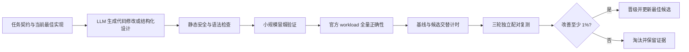

# GPGPU 算子自动优化

本项目构建并验证了一套面向 GPU 算子的自动优化闭环：**大模型生成 Triton 内核修改，系统自动
完成静态检查、正确性验证、真实性能测试和候选晋级**。当前已在 NVIDIA V100 32GB 上完成 KDA
（Kernel Design Agents）工作流适配，并产生首个经过三轮复测后稳定晋级的优化候选。

> 当前成果的核心关键词是 **自动化算子优化**。Poly 调度和 Halide IR 规范化仍是后续接入方向，
> 目前没有将参数搜索或 Triton 源码处理包装成已完成的 Poly/Halide 成果。

## KernelWiki 天数 BI-V150 适配

在保留 KernelWiki 原有 Hopper/Blackwell 页面及性能数字适用范围的基础上，项目增加了 Iluvatar
BI-V150 的架构检索、工具链说明、算子案例和 **17 项逐项迁移账本**。实验固定在 BI-V150、
CoreX 4.2.0、厂商 Triton 2.1.0；所有候选保留正确性检查、逐轮计时及失败记录。

**最新实测：固定 MoE 带权 SwiGLU004 的独立扩大形状复验（阶段35，10月11日）。** 候选和25份控制器字节保持不变，在同一 BI-V150 上对比 Megatron 原生后端。

| 模型 | 原生 ms/step | 优化 ms/step | 组合吞吐提升 | 带权 SwiGLU 增量 |
|---|---:|---:|---:|---:|
|4专家、序列256|76.20–77.48|70.57–71.09|**8.13%**|**4.50%**|
|8专家、序列512|112.99–114.00|103.42–103.99|**9.34%**|**6.00%**|

增量相对同轮“交叉熵＋梯度范数”控制组，组合收益相对同轮原生后端；两组的三个种子均更快。
18个接受的正式进程共2160步，沿用原生 GPU 同步后的 `time.time` 区间，排除前20步。
两组三向三步比较各通过2627／3843项检查，1289／1993个张量全部逐位一致，包含 FP32 master 和路由概率梯度。
384份新轮原件完整归档并核对 SHA256，合计22.29GB，去重后9.98GB；资源检查与本机完整字节验收通过。
首轮4专家测试因结束后进程状态未明而未获接受，原件作为诊断保留，采用完整独立复测。
8专家组同时改变序列长度，收益不能单独归因于专家数。结果限于单卡、模拟数据和 SGD。

阶段35通过第五份增量补丁接入知识库：**1079页、1010个来源ID、38条 BI-V150 路径**，162项测试通过，生成、独立重建和 KDA 项目加载核对4923个文件。前四份补丁和原1077页字节保持一致，NVIDIA 检索集合不变。
见[本轮封存决定](experiments/kernelwiki_iluvatar/megatron_bf16/moe_scale_recovery01/evidence/decision-retry01-02.json)、[完整归档](experiments/kernelwiki_iluvatar/megatron_bf16/moe_scale_recovery01/evidence/raw-http-backup-retry01-01-receipt.json)和[9月30日以来的报告](experiments/kernelwiki_iluvatar/PROJECT_REPORT_0930.md)。
10月9日旧轮的11.09%／10.30%记录单独保留，旧原始张量备份未齐；新采集不能补记为旧文件已恢复。

**此前已交付：MoE 带权 SwiGLU 正式训练（阶段34）。** 在4层、4专家、top-k=2、55,652,864参数的 BF16 模型中，
Claude Code CLI 生成并迭代4个候选。独立复验中，新增带权激活相对同轮“交叉熵＋梯度范数”控制组再提升 **5.77%**，
组合相对原生 SequentialMLP 后端提升 **9.25%**，三个种子均更快。训练从72.32–74.15降至66.47–67.35毫秒/步。
原生默认融合 SwiGLU、融合 causal softmax和RMSNorm作为基线；仅增加带权激活候选，GEMM与路由算法保持原生。
三向三步比较各通过2627项检查、1289个张量比较，全部逐位一致，包含路由概率梯度与FP32 master。
首轮曾得到17.03%的增量、26.19%的组合收益，但部分基线波动较大；完整复验后采用上面的较稳定数字，两轮原始数据均保留。
范围限于单卡、模拟数据、SGD；见[独立复验原始记录](experiments/kernelwiki_iluvatar/megatron_bf16/moe_weighted/evidence/confirmation/performance-004.json)。

**此前结果：固定 Attention003 的较大模型复验（阶段32）。** 8层、42,213,888参数、序列512的 BF16 模型中，
Attention 相对同轮“交叉熵＋梯度范数”控制组再提升 **4.41%**，组合相对原生后端提升 **8.21%**，三个种子均更快。
4层、21,107,200参数、序列256模型的增量为 **3.14%**，但有一个种子变慢，未获推广。三臂都保留原生默认融合 softmax 与编译 SwiGLU；
本轮没有启用 SwiGLU004，也没有重新调参。见[较大形状原始测速](experiments/kernelwiki_iluvatar/megatron_bf16/attention_scale/evidence/performance-deep-003-complete02.json)。

**此前已验证：Attention003 正式训练（阶段31）。** 在四层、17,895,936 参数的 BF16 模拟训练中，
新增 Attention 相对同轮“交叉熵＋梯度范数＋SwiGLU”版本再提升 **4.51%**；四项组合相对原生后端提升
**13.96%**，三个种子均更快。三臂都启用原生默认 CUDA causal softmax 融合（`masked_softmax_fusion=True`），RMSNorm 保持原生。
三份三步训练比较各通过1475项检查、637个张量比较，全部逐位一致，包含 FP32 master。
性能另跑三个种子、三臂共九个进程，每个120步并剔除前20步；主指标为原生 GPU 同步后的 `time.time` 训练区间。
候选由 Claude Code CLI 生成，复用厂商融合 softmax，通过 TorchScript 减少重复调用开销。结果限于这组单卡、小模型、模拟数据。
见[本轮验收](experiments/kernelwiki_iluvatar/megatron_bf16/attention/evidence/decision.json)。

| 已验证内容 | BI-V150 实测结果 |
|---|---|
| MoE 固定候选扩大形状复验（阶段35） | 10月11日新轮：4专家S256／8专家S512增量 **4.50%／6.00%**，组合相对原生 **8.13%／9.34%**；两组均三个种子更快，384份原件完整归档，资源门槛及完整字节验收通过。旧轮与首轮诊断单独保留 |
| BF16 较大 Attention 模型复验（阶段32） | 固定 Attention003、默认融合 softmax=True、原生编译 SwiGLU；4层S256／8层S512相对同轮 CE＋梯度范数增量 **3.14%／4.41%**，组合相对原生 **9.50%／8.21%**。8层模型通过推广门槛，4层模型有一个种子变慢，未推广。三向数值比较每份1475／2371项检查全部通过、张量逐位一致 |
| MoE 带权 SwiGLU 训练（阶段34） | 4层、4专家、top-k=2、55,652,864参数；新增候选004相对同轮 CE＋梯度范数提升 **5.77%**，组合相对原生 **9.25%**。两轮完整三种子测试均通过；每份数值比较2627项检查／1289个张量，逐位一致。GPU布尔稳定排序共用已验收的0/1 uint8映射；未启用GroupedGEMM |
| BF16 较大 SwiGLU 模型留出复验（阶段30） | 固定阶段29候选004，三臂沿用关闭 softmax 融合的历史模板；序列256的4层模型、序列512的8层模型相对同轮 CE＋梯度范数增量为 **0.5964%／1.1899%**，均有一个种子略慢，未推广。首版元数据绑定错误，仅保留作诊断；结果使用修正版重新运行 |
| BF16 正式训练：SwiGLU（阶段29） | 相对同轮 CE＋梯度范数再提升 **3.11%**，组合相对原生提升 **8.87%**；37个算子 case、4个分派检查及三步训练检查通过。首版虽数值通过，但相对已有优化退化2.17%，未采用 |
| BF16 正式训练：RMSNorm 点运算融合（阶段27） | Claude Code 生成原生 C++/CUDA 融合，保留原生 BF16 归约与梯度图；3种子、9进程共1080计时步，相对同轮 CE＋梯度范数版本再提升 **2.03%**，合计相对原生后端提升 **7.99%**；1475项完整训练检查通过，637个被比较张量逐位一致 |
| BF16 较大模型留出验证（阶段28） | 固定代码扩展到4层序列256／8层序列512，原生三步检查1475／2371项均通过；组合优化相对同轮原生吞吐 +4.65%／+5.06%。新增 RMSNorm 在两种形状均未通过推广门槛，保留原始结果 |
| BF16 正式训练：梯度范数传输合并（阶段26） | 四层合成 GPT，保留原生 GPU `torch.norm`，将逐张量取回 CPU 标量合并为一次传输。3 个种子、9 个进程共1080计时步：相对同轮 CE 0008 再提升 **3.87%**，合计相对原生后端提升 **4.41%**；三步1475项检查通过，张量与实际梯度范数逐位一致 |
| Residual Add RMSNorm 融合 | FP16/BF16、5 个形状、各 3 轮通过前向与参考梯度检查；前向相对**未融合 PyTorch 算子序列**为 10.12–14.65× |
| Megatron 正式训练入口：10 月 3 日 | 同一四层 FP32 合成 GPT，正式 `pretrain_gpt.py` 使用原生模拟数据、DDP 和 SGD；三组各120步对照吞吐提升 **7.63% / 7.28% / 6.01%**，几何平均 **6.97%**。三步逐 token loss、全部梯度与参数更新通过737项检查 |
| Megatron 真正 BF16 正式训练：10 月 3 日 | 全部模型权重为 BF16、SGD master 为 FP32，关闭 autocast；4/8 层、三种序列/词表规模通过三步数值核对。CE 反向融合的 0008 首轮吞吐提升 **4.62% / 0.11% / 1.16%**；新增 BF16 梯度转换融合的 0009 未稳定胜过同轮 0008，保留 0008 为默认。45 个计时进程共5400步，完整张量正确性另做三步审计 |
| Megatron 原生后端：阶段 24 历史结果 | Claude Code CLI 保留原残差/RMSNorm，新增 TP=1 词表交叉熵融合；同一四层 FP32 合成 GPT 三轮完整 step 倍率为 **1.2028/1.2133/1.1577×**，几何平均吞吐提升 **19.10%**。输出、loss、全部参数梯度与 SGD 更新通过 CPU 数值复核 |
| Megatron 原生后端：阶段 23 历史结果 | 仅融合 attention 残差加法与 RMSNorm；同一模型三轮倍率为 **1.0116/1.0162/1.0048×**，吞吐提升约 **1.08%**。原始候选和判定保留 |
| GEMM+bias epilogue | FP16/BF16、3 个形状、4 种 tile、各 3 轮通过；同 tile 相对**单独执行 bias 加法**为 1.33–3.94× |
| 流水阶段数 | FP16/BF16、两种形状与两种 tile 的留出复测全部数值通过；BF16 1024³、64×64×32 tile 上，`num_stages=2/3` 相对 1 仅为 0.915×/0.748× |
| 知识库与加载回归（阶段31） | 两份补丁按 SHA 清单重建，基础补丁保持不变。1073页、1007个来源ID；BI-V150 精确检索32条路径，原1069页字节及 NVIDIA 的286/379条检索路径一致。160项测试通过，3924个文件在 KDA 项目目录逐文件核对；新增673个小型证据文件，原始张量在本地去重保存 |
| 知识库与加载回归（阶段32） | 三份补丁顺序重建，前两份 SHA 不变。1075页、1008个来源ID、BI-V150检索34条；原1073页及 NVIDIA 检索集合一致。160项测试通过，KDA项目4171个文件逐一核对，新增242个小型证据文件；本轮96份原始文件去重后约3.55GB，数值证据缺失0 |
| 知识库与加载回归（阶段34） | 四份补丁独立重建，前三份SHA不变；1077页、1009个来源ID、BI-V150检索36条，原1075页及NVIDIA路径集合保持一致。160项测试及两项新证据篡改检查通过，4585个文件在生成、重建和KDA项目加载目录逐一核对；本轮332份原始文件去重后约5.16GB，远端原件保留 |
| 知识库与加载回归（阶段35） | 五份补丁独立重建，前四份SHA不变；1079页、1010个来源ID、BI-V150检索38条。162项测试通过，4923个文件逐一核对；新增333份小型证据文件，原1077页和NVIDIA检索集合保持一致 |

表中的 10× 级加速是单卡算子微基准。**FP32 正式入口吞吐提升为6.97%**：相对同一张 BI-V150 上的固定 Megatron 原生本地 PyTorch 后端，原生循环从30.86–31.59 ms/step降至29.11–29.38 ms/step；包含原生数据与调度、DDP和SGD，排除启动、checkpoint与评估。原生600个源码文件哈希一致，显式优化开关安装候选，原始日志与数值证据见[正式入口验收](experiments/kernelwiki_iluvatar/megatron_training_entry/evidence/performance-120-validated.json)。**历史19.10%使用独立完整step基准**，从约11.50–11.68 ms降至9.55–9.93 ms，排除数据与checkpoint I/O；两个计时范围不能互换。这组 FP32 结果仅覆盖所测单卡四层合成模型。FP8 `tl.dot` 在当前软件栈
编译失败；TMA、TMEM、warp specialization 等 NVIDIA 机制没有被改标为 BI-V150 的硬件等价能力。
适配版 skill 和 KDA 仓库级通用加载器以补丁保留在本仓库，由 CI 验证重建、加载及知识库。阶段24三轮通过 1512 个交叉熵有限值 case-round 和 672 个残差有限值 case-round；另有 378 个原生布局错误与 48 个原生非有限值 case-round 单独核对兼容性。越界 int64 标签和实际 CE 编译内核执行也通过独立审计。当前 CoreX 的 GPU float64 比较出现零误差假象，验收采用 CPU 比较且保持容差。

此前 BF16 autocast 场景未运行 Triton CE。新一轮采用真正的全模型 BF16 权重，在三种规模上验证了 Triton CE 反向；0009 的三步 loss、全部梯度、BF16 权重及 FP32 master 均与原生逐元素完全相等。其后续相对原生吞吐变化为 **+2.74% / +3.06% / +0.39%**，相对同轮 0008 的结果有波动，不能认定稳定升级。原生前向和 BF16 RMSNorm 保持 Torch 计算，详见[BF16 验收数据](experiments/kernelwiki_iluvatar/megatron_bf16/evidence/decision.json)。生产配置、多卡与 TE 收益尚未验证。按项目决定，不向 KDA 上游提交 PR。

从仓库根目录重建 skill（脚本固定上游提交，按 `skill-patches.json` 校验并依次应用基础与增量补丁；目标目录须尚不存在）：

```bash
python experiments/kernelwiki_iluvatar/build_skill.py --output /path/to/kernelwiki-iluvatar
python /path/to/kernelwiki-iluvatar/scripts/validate.py
python -m unittest discover -s /path/to/kernelwiki-iluvatar/tests
```

构建所需的上游源码由脚本拉取；仓库保留本项目补丁、实验脚本和原始证据，不复制第三方完整语料。
KDA 项目级加载器由[`build_kda_integration.py`](experiments/kernelwiki_iluvatar/build_kda_integration.py)从固定提交和补丁构建，并由[`verify_kda_integration.py`](experiments/kernelwiki_iluvatar/verify_kda_integration.py)把准备好的 skill 加载到该 checkout 的 `.claude/skills/`。这一路径无需个人安装，原 KernelWiki 子模块保持原样。完整证据、边界和计划见[工作总报告](experiments/kernelwiki_iluvatar/PROJECT_REPORT_0930.md)与[阶段 24 最终验收数据](experiments/kernelwiki_iluvatar/megatron_cc/higher_gain/evidence/decision-0006.json)。

## 核心成果

| 成果 | 验证范围 | 结果 |
|---|---:|---:|
| GDN Decode V100 适配 | 54/54 官方 workload + 3个边界分支 | 全部正确 |
| GDN Prefill V100 适配 | 100/100 官方 workload + 2个边界分支 | 全部正确 |
| 普通 PyTorch → 结构化 Agent | 54组同轮配对测量 | **10.985×，正式晋级** |
| Decode Agent 候选 | 三轮、162组配对测量 | 改善0.46%，低于门槛，自动淘汰 |
| Prefill Agent 候选 | 三轮、300组配对测量 | **改善1.454%，正式晋级** |
| Residual Add RMSNorm | 6种形状，前向与参考梯度 | 全部通过严格复核 |

模型对 Prefill 热循环中的状态更新做了等价代数化简：

```python
# 修改前
new_v = beta * v + (1. - beta) * old_v
state = old - k * old_v[:, None] + k * new_v[:, None]

# Agent 修改后
delta = beta * (v - old_v)
state = old + k * delta[:, None]
```

新形式减少了循环内中间结果和逐元素运算。候选不是因为“看起来更简单”而晋级，而是在全部输入
正确、三轮配对结果方向一致且综合改善超过1%后才进入最佳候选账本。

## 自动优化闭环



整个过程保存模型响应元数据、候选源码和哈希、逐 workload 误差、21次原始计时、边界分支结果
以及不可变决策账本。验证子进程不会继承模型 API 密钥。

## 性能分析

### Agent 优化结果

| 实验 | 基线几何平均 | 候选几何平均 | 综合变化 | 候选胜出 |
|---|---:|---:|---:|---:|
| Decode 普通 PyTorch → 结构化 Agent | 0.256053 ms | 0.023308 ms | **10.985×** | 54/54 |
| GDN Prefill | 0.312883 ms | 0.308335 ms | **提升1.454%** | 248/300 |
| GDN Decode | 0.022807 ms | 0.022702 ms | 提升0.46% | 124/162 |

普通基线实验由模型选择融合策略、`ROWS=4`、4 warps 和递推化简，控制器将设计降为受限的
sm70 Triton 模板并执行全量验证。该 `10.985×` 是相对 eager PyTorch 的流程内总收益；相对强
Triton 基线的增量仍按下述配对复测报告。Prefill 三轮独立改善分别为 `1.420%`、`1.469%` 和
`1.472%`，波动较小且均超过1%。Decode
首次跨运行比较曾显示约1.10%改善，但同进程交替复测后只有0.46%，因此没有晋级。这说明配对
复测可以过滤微秒级 kernel 的计时噪声。

### V100 调度与融合结果

- **GDN Decode：** ROWS=1/4/8/16 均正确；最终 ROWS=8 赢47组、ROWS=4赢7组。逐 workload
  获胜调度相对批量 PyTorch 表达式的几何平均加速为 `11.68x`。主要收益来自减少中间张量和
  kernel 启动；该基线不是 B200 上的 FlashInfer 优化实现。
- **GDN Prefill：** ROWS=4/8/16 共300次正确性验证全部通过。固定 ROWS=8 的几何平均延迟为
  `0.3179 ms`，逐 workload 选择最快调度后为 `0.3096 ms`，进一步降低约 `2.67%`。
- **Residual Add RMSNorm：** 融合 Triton 候选在6种形状上相对未融合 PyTorch 表达式取得
  `5.60x–10.13x` 加速，并通过严格的前向和参考梯度比较。该数字是 CUDA Graph 微基准结果，
  不代表端到端训练加速或相对厂商融合库的优势。

`nvcc` 和 `ncu` 已安装，但当前平台未开放 NVIDIA GPU 性能计数器，采集会返回
`ERR_NVGPUCTRPERM`。因此现阶段可以确认延迟改善，尚不能用硬件计数器进一步归因到带宽、指令、
占用率或寄存器压力。

## 官方任务覆盖

| KDA 任务 | workload | 当前状态 |
|---|---:|---|
| GDN Decode | 54 | 全量验证、计时和 Agent 优化完成 |
| GDN Prefill | 100 | 全量验证、计时和 Agent 晋级完成 |
| DSA TopK Indexer | 128 | 已审计任务定义；V100 尚未完成 FP8 软件解码验证 |
| DSA Sparse Attention | 23 | 已审计任务定义；尚未实现 V100 候选 |
| FP8 MoE | 19 | 已审计任务定义；V100 只能进行有限语义验证 |

当前完成2/5项 V100 官方任务。V100 上的核心 Agent 闭环已跑通；B200 官方环境、其余三项任务和
ncu 性能剖析尚未完成。上文的 BI-V150 KernelWiki 知识适配已通过实机微基准，五项官方任务的
BI-V150 迁移仍需另行完成。

## 环境与可复现性

| 项目 | 固定环境 |
|---|---|
| GPU | Tesla V100-PCIE-32GB，SM70 |
| Python | 3.10.12 |
| PyTorch | 2.5.1+cu121 |
| Triton | 3.1.0 |
| 官方数据修订 | `5e832ce88dd1013032b22a0e942979d7d2769cc3` |
| 当前模型标识 | `Claude-Opus-4.8`（学校兼容 API 返回标识） |

一次性复跑 GDN Decode 和 Prefill：

```bash
cd "$HOME/gpgpu-cake"
git pull --ff-only origin main
KDA_CA_BUNDLE="$HOME/.local/share/ca-certificates/scholar-git-ca-bundle.pem" \
  bash experiments/kda_repro/scripts/run_official_v100.sh all
```

运行 Prefill Agent：

```bash
nohup bash experiments/kda_repro/scripts/run_gdn_prefill_agent.sh 1 \
  > "$HOME/kda-repro/agent-prefill.log" 2>&1 < /dev/null &
```

从普通 PyTorch 基线运行结构化 Decode Agent：

```bash
nohup bash experiments/kda_repro/scripts/run_gdn_decode_ordinary_agent.sh 1 \
  > "$HOME/kda-repro/agent-decode-ordinary.log" 2>&1 < /dev/null &
```

模型服务配置、候选目录和三轮复核命令见
[Agent 接入说明](experiments/kda_repro/AGENT_SETUP.md)。API 密钥必须保存在仓库之外。

## 报告与证据

| 内容 | 文档 |
|---|---|
| 上周 Agent/Triton：任务覆盖、晋级判定与复跑 | [Agent/Triton 自动优化实验总报告](experiments/kda_repro/AGENT_TRITON_REPORT.md) |
| KernelWiki/BI-V150：17 项迁移、Megatron 原生闭环、局限与 ixSYS 步骤 | [KernelWiki 天数适配总报告](experiments/kernelwiki_iluvatar/PROJECT_REPORT_0930.md) |
| CAKE、Poly 与 Halide IR 前期调研 | [研究资料索引](research/README.md) |

原始 JSON、候选源码和 API 元数据位于 `experiments/kda_repro/evidence/`。上游 KDA、竞赛、
FlashInfer Bench 和 DeepGEMM 提交记录在
[`source-lock.json`](experiments/kda_repro/source-lock.json)。

## 结果边界

本项目使用公开数据与 reference，在 V100 上复现 KDA 的工程思想和验证闭环。当前结果不是
NVLabs 官方 Agent 工具链输出，不是 B200 官方 evaluator 成绩，也不能直接代表端到端模型性能。
这些边界均保留在结果报告和原始证据中。

阶段26的梯度范数结果只覆盖四层 BF16、单卡、SGD、关闭梯度裁剪的模拟训练。它减少 CPU/GPU 同步与传输，保留原有 GPU 范数计算；并非新的 Triton 归约内核，也未验证 TE/Apex 后端收益。两项改善使用同轮对照，不能与历史批次的百分比相加。见[原始验收](experiments/kernelwiki_iluvatar/megatron_bf16/evidence/gradnorm-stage26/decision.json)。

阶段27的 **7.99%** 来自同轮原生／CE＋梯度范数／新增 RMSNorm 三臂对照，不能由历史百分比相加得出。5轮 Triton 迭代的退化与数值失败保留；第6轮原生 C++/CUDA 候选仅在固定四层 BF16、单卡 SGD 模拟训练中通过验收。[RMSNorm 验收](experiments/kernelwiki_iluvatar/megatron_bf16/evidence/rmsnorm-stage27/decision.json)。

阶段29的 **8.87%** 使用新的1790万参数 SwiGLU 模型和同轮三臂对照，未包含阶段27的 RMSNorm 候选。
两轮共18个120步性能进程，逐进程剔除前20步；正确性另做三步全张量审计。当前只覆盖单卡、小模型、
模拟数据和 SGD。较大 SwiGLU 留出复验已在阶段30完成，两种模型均未推广；阶段31另以默认融合 Attention 后端重新对照，四项组合达到13.96%。旧阶段30首版与 Attention002 的元数据绑定错误记录仅用于诊断。下一步验证新增 Attention 的较大形状，并为 MoE 建立独立的原生后端、模型与负载契约。
