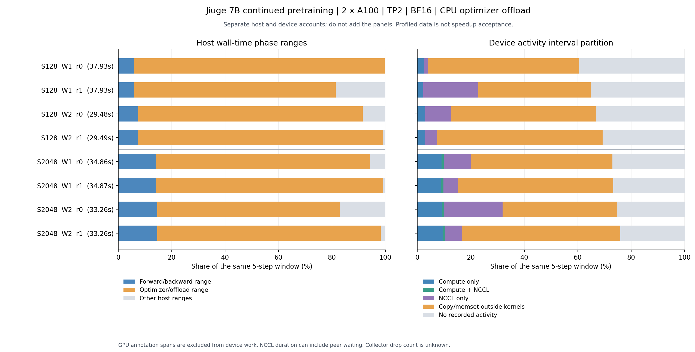
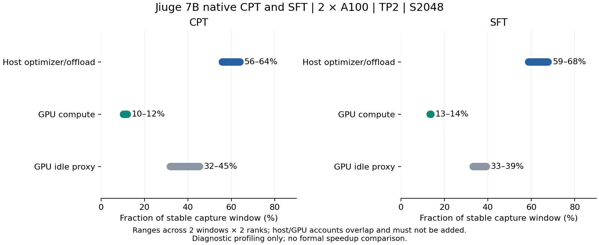
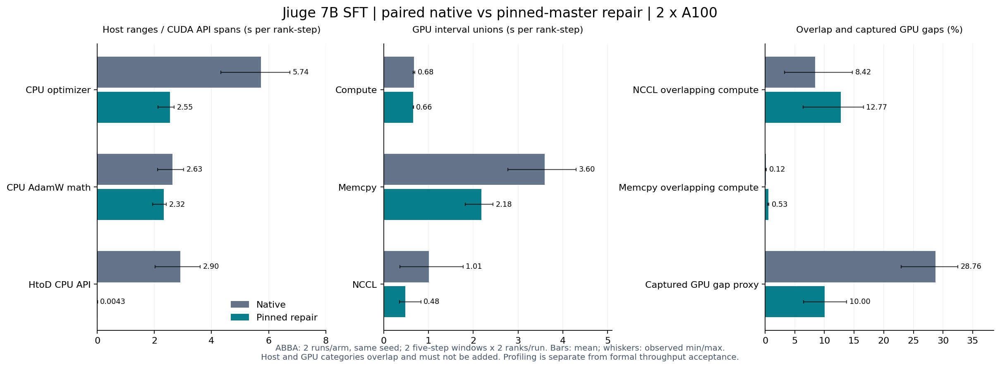
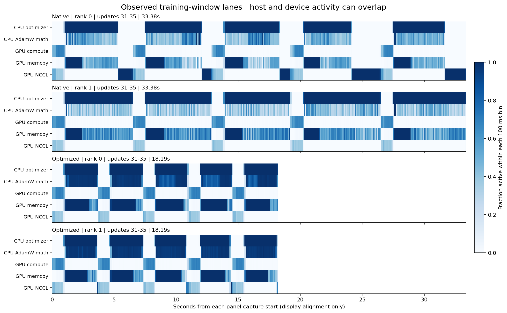
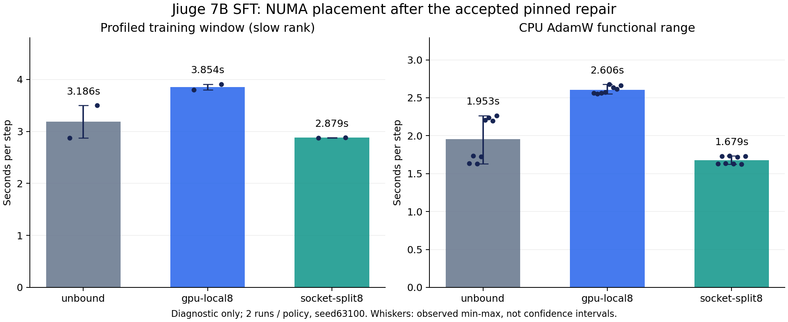
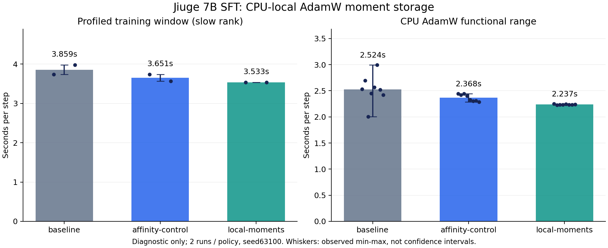

# 九格 7B 训练与微调：原生验证、端到端 tracing 与后续计划

更新：2026-10-23。**九格7B的CPT与全参数SFT tracing均已完成；pinned memory修复通过全状态正确性、原生断点恢复和独立正式性能验收。CPT吞吐相对原生Megatron提升84.4%，SFT提升92.9%。** 两个结果来自各自任务的正式对照，不能相互替代；SFT验收与修复前后的配对时间线见第十七、十八节。10月23日，两阶段CPU绑核与直接创建moment的候选通过真实7B首步和六组35步筛选，新增24份时间线；诊断窗口平均耗时由3.859降至3.533秒/步，倒数比约+9.2%，相对仅绑核对照约+3.3%。**新增结果仍须完整正确性、原生恢复和无profiler正式吞吐验收，不与旧提升相加或相乘。** 见第二十二节；本阶段已结束并暂停。

模型为官方九格 `9G7B_MHA`（28层、约76.69亿参数），使用ACT双A100、TP2、S2048和原生Torch后端。10月17日完成同一分配上的CPT/SFT原生时间线，共8份；10月20日又在SFT正式验收的同一物理卡对上完成原生/修复版ABBA对照，共16份。原件及日志保存在ACT，压缩与解压SHA核验通过。

完整训练链包含QKV/FFN矩阵乘、MHA attention、RMSNorm、SwiGLU、RoPE和交叉熵，以及CPU AdamW、主机/显卡搬运和NCCL通信，未加入新的Triton算子。**SFT修复前后，HtoD主机调用范围由约2.90秒/步降至4.33毫秒，CPU AdamW与HtoD重叠由0增至1.58秒；搬运量相同。** 修复后CPU AdamW仍约2.32秒/步，通信与计算重叠仍有限。profile区间可以重叠，不用于重新计算正式加速比。

10月21日完成SFT的NUMA受控诊断，新增24份时间线。以已验收的pinned版本为基线，GPU本地绑核两次均更慢；分散到两个CPU插槽的方案较稳定，但未稳定优于不绑核。两项候选均未通过本轮筛选，没有新增正式加速比；三步全状态、断点恢复与120步/三种子/三臂标准保持不变，详见第十九节。

以下表格汇总此前CPT验收；后续各节按日期保留实验过程。已接受的SFT性能见第十七、十八节，最新候选筛选见第二十二节。

| 验证项目 | 当前结果 |
|---|---|
| 原生训练与时间线 | 128及2048-token两种配置各完成3步验收和35步训练，取得8份诊断timeline |
| 实际内存属性 | 两rank各199个FP32 master保持pinned；恢复加载中的4次参数重建均通过检查 |
| 三步全状态正确性 | native、control、optimized各覆盖每rank 3,585项；control及修复版相对原生最大误差均为0 |
| 真实检查点恢复 | 修复版每rank 995项恢复状态、1,195项下一步状态与原生连续训练原件零差异；输入、mask、RNG及scheduler检查通过 |
| 完整原件校验 | ACT上的18,601个唯一数值块及约100GiB检查点完成校验；本次四个关键包合计约7.5MB，本机逐文件SHA通过 |
| 正式性能 | 9组独立训练均完成120步；剔除20步预热后按原标准通过验收，原生/control波动未触发复测 |
| 修复后时间线 | 原生/修复版各35步、两窗口两rank，共8份新trace完成采集、ACT原件校验及拷贝/通信分析；诊断耗时不参与上述吞吐验收 |
| 新增NUMA候选 | 三步全状态审计通过，每rank 3,585项最大误差为0；完整恢复及下一步零差异；新语义/原件总校验和正式测速尚未完成，详见第十四节 |
| CPT与SFT同资源tracing | 两任务各3步准入和35步运行全部通过；8份新trace完成压缩/解压SHA核验，24份冻结源码及144份ACT原件记录核验通过，详见第十六节 |

选择此修复来自实际时间线：2048-token窗口中，优化器/offload的CPU范围约占68%–85%，GPU计算区间约占10%，主要消耗还包括主机与显卡搬运及rank间等待。CPU范围包含等待，不等于纯CPU计算耗时；这些范围与GPU区间不能直接相加。

本轮数据归属于A100及当前CPU offload配置。天数BI-V150、多机多卡和其他训练配置需独立复验。修复版种子均值CV为13.6%，其波动单独保留，详见第十三节。

项目仓库：[GitHub](https://github.com/yangpu-333/gpgpu-cake)、[GitLab](https://gitlab.ci-lab.net/yangpu/gpgpu-cake)。第十至十二节保留各时点的执行记录和失败证据；已通过的性能结论见本节摘要及第十三节，第十四节记录后续增量验证。

## 一、目标与关键要求

本周个人交付是：在至少双卡环境中，以真实九格 7B 权重和指定中文 Alpaca 数据跑通 Megatron 继续预训练，采集完整任务负载的时间线，同时分析计算、通信、等待及其重叠，筛选最值得优化的对象。

团队总体覆盖九格 8B、7B、4B 的训练与微调，采用一致的记录和分析口径，比较各负载的优化机会。个人最初负责7B继续预训练；10月17日交付范围增加同一7B的全参数SFT，其他规格需另行实际运行。

关键要求：

1. 先取得真实任务 timeline，再按关键路径和稳定热点选择优化对象。
2. 计算与通信共同分析，关注计算加速后是否会暴露通信、是否影响原有重叠。
3. 单机至少双卡作为前期环境，最终仍需多机多卡复验。
4. 真实权重、全部参数训练、实际优化器更新、真实数据；微基准和小张量通信检查不能替代任务验证。
5. 后续优化收益仍按原有统一测评标准验收，profiler 数据用于归因。

## 二、当前已具备的准备条件

以下包含截至 2026-10-16 的执行记录；每次启动 GPU 任务仍重新检查占用。

| 项目 | 已有记录 | 尚需验证 |
|---|---|---|
| ACT 资源 | e2bcb在xfusion-2完成两任务，16核/224GiB/双A100；各运行前后分配卡占用检查通过；作业已自动完成、累计0点；旧V100保留 | 新实验须重新取得分配并检查占用 |
| 卡间连接 | 本轮xfusion-2为`PIX`、两卡同属NUMA0；旧inspur-gpu-04为`SYS`、跨NUMA；均无NVLink | 新旧节点的诊断耗时不能直接当作优化前后比较；本轮CPT/SFT使用同一分配 |
| SSH | e2bcb运行期30299严格免密登录通过，UID/GID1001；任务完成后该容器退出；旧V100入口`ssh huids25@192.168.5.200 -p 30353`仍可访问共享原件 | Pod 重建后重新核对入口及账户 |
| 7B 权重 | 官方 `9G7B_MHA` 的13个唯一文件完整下载；339个BF16张量，7,668,831,744个参数元素；TP2 全部加载分片逐字节校验；原生iteration 2检查点及候选恢复/下一步全状态验收通过 | 更长训练与其他并行配置需另行验证 |
| 数值桥接 | 32/64/128-token 三组原始 FP32 logits/loss 对照通过；保留双方数值原件 | 不等同于后续优化的全梯度、全部 AdamW 状态数值验收 |
| 数据 | 48,818条；原生分词共7,704,875 tokens；逐文档 EOD 检查通过；2048-token 实际 batch 与全文 loss mask 已保存 | 更大训练数据和实际生产配置需另行冻结 |
| Megatron | 固定提交及600个源码文件逐字节核验；使用上游 local Torch 后端、原生 AdamW CPU offload | Transformer Engine/Apex 后端尚未安装验证 |
| 采集能力 | 128和2048-token真实任务各完成独立35步；每种配置均有两窗口、两rank的GPU和NCCL记录；每窗口每rank922个通信kernel | collector 丢事件计数不可得、关键路径依赖需继续补证 |
| 分析程序 | 两种序列均完成按rank/device的区间分析；排除GPU annotation跨度重复计账，13项统计测试通过；已保存通信组、dtype、元素数、逻辑字节数和跨rank匹配候选 | 原生通信sequence编号及关键路径依赖仍需进一步确认 |

此前NUMA作业使用`sleep 39600`。10月17日最终SFT作业使用`timeout 21600`执行启动及控制程序，完成即退出，独立上限6小时；已在免费窗口内完成，平台累计0点。持久化目录为 `/home/huids25/kda-jiuge-prep-20261014`。不自动续期或付费延长。

旧128GiB双卡作业在第一次 AdamW 更新时被平台 OOMKilled，证据已归档；经用户确认，该失败作业已删除。旧 `KDA-V100-test` 按用户后续要求保留，没有停止或删除。

当前准备资源是NVIDIA A100。其结果只归属于该硬件；后续天数BI-V150适配和性能结论需要在天数上独立验证。

## 三、冻结模型、框架与数据语义

### 3.1 模型与框架

- 官方来源：[九格仓库](https://www.osredm.com/jiuyuan/CPM-9G-8B)、[9G7B_MHA权重](https://thunlp-model.oss-cn-wulanchabu.aliyuncs.com/9G7B_MHA.tar)。
- 7B：28层、hidden3584、FFN18944、28个Q heads及28个KV heads，MHA。
- 保留Q/K/V projection bias、标准残差、RoPE theta=1e6、RMSNorm epsilon=1e-6、真实词表73448及原tokenizer。
- 该7B没有此前8B thinking的额外embedding/残差/LM head缩放。两种模型的checkpoint、配置和桥接分别记录。
- 框架固定 `Megatron-LM@5be9626709af2722333bf54797c954c09edeada3`；必要兼容修改须保存补丁及哈希，所有对照使用相同修改。
- 28个注意力头支持常规TP2/TP4整分，不直接套用8B方案中的TP8。
- 已校验 QKV 按 head 交错、gate/up 独立分片再拼接、词表分片、全部加载分片字节以及三组 FP32 logits/loss；本轮三步全状态和候选检查点恢复/下一步更新等价也已通过，详见第十二、十三节。

### 3.2 指定数据的继续预训练口径

数据来源：[alpaca_gpt4_data_zh.json](https://github.com/Instruction-Tuning-with-GPT-4/GPT-4-LLM/blob/main/data/alpaca_gpt4_data_zh.json)。

- 已冻结revision：`80cda626ea305004be42426671c66efebbf22144`。
- 原文件SHA256：`6fcb98c6d79691d1f9a88ef513335da9124e7fdeef5103343f5d9f9a6e8f4903`。
- 处理后全文JSONL SHA256：`38b6534e0a8ac5278c72adc69ce7f80f10c9bfc0dacc204bde8e73686efcd335`。
- 保留原48,818条及顺序，将instruction、可选input和output按固定模板拼接为文本。
- 继续预训练采用全文next-token loss：全部有效非padding位置参与，显式加入文档结束标记。
- 仅答案部分参与loss属于SFT口径，另立配置及结果，不能与本轮混记。
- tokenizer 为官方 FM9GTokenizer，保留默认 BOS，使用原生预处理 `--append-eod` 加入73440；原生 GPTDataset packing，固定 seed63100。2048-token 验收中，两rank各3个实际 batch 的 loss mask 全为1、有效位置2048，labels 与下一 token 移位一致。未启用 inter-document attention masking 或 position reset；不插入答案专用 mask。

## 四、环境与并行策略

### 首选试验配置

已采用单机双卡 `TP2 / PP1 / CP1 / DP1`，BF16权重、FP32梯度/master/moments，micro/global batch均为1、每步一次micro-batch，完整层级recompute。128和2048两个序列配置分别编号归档，不能把二者耗时混作优化前后对照。

该配置主要暴露TP通信，不能据此声称DP梯度同步、PP流水线或多机网络均已验证。

### 容量是启动前置条件

按BF16权重、FP32梯度/master、AdamW moments估算，7B常驻状态约128.56GiB，不含激活、临时缓冲与通信。双40GB卡无法让这些状态全部常驻GPU。

当前使用原生 `HybridDeviceOptimizer`、100% CPU optimizer offload 和异步D2H/H2D。128-token 35步采集的容器内存采样峰值为209,970,905,088 bytes，约195.6GiB（2秒一次，含缓存，非内核精确峰值）；每卡峰值分配约28.6GiB。256GiB曾容纳原生35步训练，但不能据此推断完整检查点恢复审计的容量；后者在256GiB下发生OOM，现使用300GiB续验，详见第十二节。最低可用内存尚未测定。

执行时依次检查：

1. 固定Megatron的分片、CPU optimizer offload及精度感知优化器路径是否可用。
2. 若可用，核实GPU和主机峰值、数据迁移及AdamW状态；offload本身计入真实训练负载。
3. 若原生路径不可用或容量不足，调整资源/并行配置，保存新方案，重新做完整step验证。
4. 不通过缩小模型、冻结大部分参数、改成LoRA或替换优化器来冒充原任务。

若资源允许，再独立增加DP2或PP2的诊断配置。每种配置分别验证容量和输入，记录其用途；不同配置的耗时不能直接混作优化前后对照。

## 五、分阶段执行计划

| 阶段 | 工作 | 完成条件与产物 |
|---|---|---|
| A：输入与资源冻结 | 核对真实权重、tokenizer、框架、数据、运行时、GPU及并行映射；确认无人同时占用实验卡 | 一份可复现启动契约、哈希清单、资源与拓扑记录 |
| B：原生任务跑通 | 验证7B桥接、完整前反向、实际AdamW更新、有效loss、训练参数和checkpoint恢复 | 真实7B完整step通过；记录峰值及实际内存策略 |
| C：端到端采集 | 记录任务生命周期；预热后采至少两个独立稳定窗口，覆盖所有rank和完整step | 原始CPU/GPU/通信timeline、训练日志、采集配置与覆盖核验 |
| D：计算通信分析 | 分解数据、前向、反向、梯度处理、优化器、collective、拷贝和等待，检查重叠与依赖 | 主要瓶颈、原始trace定位、Top 3—5个优化机会及证据限制 |
| E：团队横向比较 | 以相同字段汇总8B/7B/4B及训练/SFT实际结果 | 各负载热点和通信特征对照；选择机会最多的对象 |
| F：后续优化验收 | 只在选定真实调用点运行CC CLI＋KDA/KernelWiki迭代，再验数值和无profiler吞吐 | 算子结果、端到端收益、通信变化及回退证据 |

本周优先完成A—D。优化迭代及性能提升属于后续阶段，不以“采到trace”直接宣称优化完成。

## 六、端到端 timeline 的采集范围

### 6.1 两种粒度配合

1. 任务全程记录阶段标记与日志：加载权重、分布式初始化、数据输入、预热、训练循环，以及任务实际包含的checkpoint/评估与退出。
2. 稳定窗口记录详细CPU/device事件：每个窗口连续覆盖若干完整训练step，包含前向、反向、梯度处理、优化器和通信。

两种记录共同说明任务生命周期与稳定训练瓶颈。报告明确详细GPU采集窗口的起止，不把有限窗口称为全进程逐kernel采集。

### 6.2 采集要求

- 第一采集工具使用PyTorch/Kineto；NVIDIA环境按需要补充Nsight Systems依赖分析。厂商环境分别验证设备与通信事件是否真实可见。
- 每个rank独立文件；保存rank→GPU UUID→主机、TP/DP/PP group、CPU线程、GPU stream、kernel/memcpy及关联ID。
- 保存collective类型、用途、tensor shape/dtype、逻辑数据量、设备执行区间和CPU/stream等待。
- 核对CPU/GPU关联、跨rank时钟基准、事件丢失及采集错误。
- 至少两个独立稳定窗口；默认草案为预热20步后采连续5个完整step，实际预热充分性需观察确认。
- 仅在采集窗口边界排空，不在每个算子或每step人为同步；保留窗口内部原本的异步重叠。
- 两窗口使用不同run_id和输出目录；原生exporter的同名rank文件不能相互覆盖。
- 首先采低干扰CPU/GPU/通信时间线，shape/stack等更重的归因放到独立诊断轮；记录开启选项。

参考：[PyTorch profiler](https://docs.pytorch.org/docs/2.6/profiler.html)、[Nsight Systems](https://docs.nvidia.com/nsight-systems/UserGuide/index.html)。

## 七、如何选优化对象

### 7.1 必须同时展示的指标

- 完整窗口与训练step耗时、有效tokens、GPU空闲、CPU供给和offload/数据拷贝。
- 各类GPU kernel的工作总量，以及计算/通信时间区间的并集。
- 计算通信重叠量、未与计算重叠的通信区间、rank间不均衡和最慢rank。
- 前向、反向、梯度处理、优化器、数据与通信的关系，以及关键stream依赖。

CPU嵌套时间、GPU时间和不同rank耗时分别计账。NCCL kernel时长可能包含等待，不能当成纯网络传输时长；未重叠通信只是候选瓶颈，仍需依赖关系与完整任务证据。

### 7.2 候选筛选

优先选择：反复出现、实际阻塞关键路径、占用明显、存在可实现优化办法且不损害通信重叠的调用点。

观察范围包括Attention/GEMM、SwiGLU、Residual Add RMSNorm、Cross Entropy、梯度处理、AdamW及通信/CPU/offload等待。实际优化清单由trace决定。当前7B为Dense，MoE Grouped GEMM不属于这个模型的调用点。

每个候选保存：原始trace位置、输入shape/dtype/布局、原生后端、前反向耗时、通信依赖、预期修改与验证办法。累计算子占比只提供优化线索，不直接换算端到端收益。

## 八、tracing验收与后续性能验收

### 本周tracing完成条件

- 真实7B原始权重已经等价加载；指定数据在全文CPT目标下参与训练。
- 至少双卡，实际完成前向、反向、该并行配置应有的通信及优化器更新。
- 两个稳定完整活动窗口、所有rank原件、设备事件和通信可见性核验齐全。
- 有计算/通信/重叠/等待分析、Top 3—5个机会及其证据，保留边界归因不完整等限制。
- 原始trace、日志、命令、配置、哈希与查看说明归档到ACT持久目录及本机。

本轮已经取得真实任务原件。严格覆盖性门禁仍保留限制：Torch API没有暴露 collector dropped count，因此不填造0；内部step不额外同步，逐step异步归因保持未完全验证。完整窗口的GPU边界已排空，CPU/GPU launch关联和同主机时钟基准单独核对。

### 后续正式优化标准保持不变

- 对照使用相同硬件、权重、框架、数据/顺序、精度、batch、并行、优化器、recompute及offload。
- 正确性独立3步，CPU float64，atol=3e-4、rtol=1e-3；比较loss、全部梯度、更新后权重、FP32 master和实际AdamW moments，并核对恢复和mask。
- 原生GPU同步time.time；每进程120步，排除前20步，保留10个十步区间；3种子、native/control/optimized三臂轮换。
- 相对同轮control的几何平均提升严格超过1%，且三个种子均更快；native/control种子均值CV达到10%按既有规则独立完整复测。
- 正式测速前完成数值原件归档校验；2026-10-15用户明确要求“不要在本机存放过多内容，只保留关键结果”，因此本轮完整原件保留在ACT持久目录，本机保存关键结果、日志及SHA清单。其余数值、计时和提升门槛不变；计时期间不同时运行profiler、审计、checkpoint/评估或大型备份。
- 算子CUDA Event微基准单列；最终端到端吞吐与同有效工作量耗时实测。

依据：[原测评冻结计划](../kernelwiki_iluvatar/megatron_bf16/moe_scale_recovery01/plan.json)。项目文档中的最终训练/微调性能目标保留，尚未达成；本周首先交付可信timeline。

## 九、交付文件与下一步

最终交付：一份简要技术报告、全rank原始timeline、冻结启动配置和代码、原始日志/数值及SHA256清单、可视化打开说明。准备过程统一更新本README，不为每一步增加重复报告。

已有程序：

- `tracing.contract.template.json`：本周7B CPT的采集与覆盖契约，未验证字段仍保持未通过。
- `check_tracing_readiness.py`：分别检查采集前置条件和tracing交付完整性，不会启动训练。
- `analyze_trace.py`：离线统计每rank/device的完整窗口、计算通信重叠及单step归因限制。
- `prepare_alpaca_cpt.py`：指定数据的版本冻结和全文JSONL处理。
- `contract.template.json`：保留此前8B/全参数SFT正式性能草案及既有测速标准。

本轮按用户授权执行真实任务；未向模型API外发材料。下一阶段优先补齐CPU/offload与通信等待的依赖归因，再按真实调用点选择优化对象；正式性能标准继续保持原样。

## 十、2026-10-15 执行结果与原件索引

### 10.1 已完成的运行

- `results/native-smoke-08/`：原生权重映射与三组FP32前向对照；旧128GiB作业在首次优化器更新时OOM，未计为训练成功。
- `results/native-smoke-256g-01/`：128-token真实3步训练，两个rank退出成功且无跳过；每rank199组AdamW状态均到step3，保存原始状态样本。
- `results/native-profile-256g-01/`：128-token真实35步；预热20步，采集21–25、31–35，全部rank更新到step35。
- `results/native-smoke-s2048-01/`：2048-token真实3步，额外保存实际tokens、labels、position、loss mask等原件；输入复制仅用于独立验收轮。
- `results/native-profile-s2048-01/`：2048-token真实35步；相同预热和采集窗口，全部rank更新到step35。两个序列的运行互相独立，各自从官方预训练权重开始。

### 10.2 短序列时间线结果

下表为每rank的5步窗口，单位秒。优化器列为CPU范围占窗口比例，含其同步/搬运调度；GPU计算、NCCL与memcpy为各自区间并集，存在重叠，不能相加成为总耗时。

| 窗口 | rank | 窗口时长 | CPU优化器范围 | GPU计算 | NCCL | 计算∩NCCL | memcpy |
|---|---:|---:|---:|---:|---:|---:|---:|
| 21–25 | 0 | 37.930 | 93.8% | 0.970 | 0.516 | 0.037 | 21.517 |
| 21–25 | 1 | 37.928 | 75.4% | 0.819 | 7.855 | 0.033 | 16.012 |
| 31–35 | 0 | 29.484 | 84.1% | 0.868 | 2.881 | 0.029 | 16.013 |
| 31–35 | 1 | 29.487 | 91.7% | 0.871 | 1.358 | 0.037 | 18.275 |

主要观察：

1. 优化器/offload路径主导短序列；单独优化GEMM或Attention对本配置的端到端影响空间有限。
2. memcpy持续时间明显，优先检查CPU AdamW、pinned memory、NUMA位置及搬运调度。
3. 同一窗口两rank的NCCL持续时间差异很大。NCCL kernel可包含等待，需对齐相同collective及上游CPU间隙，不能将7.855秒直接解释为网络传输。
4. 计算与NCCL重叠占NCCL并集约0.4%–7.2%；这是捕获区间的描述，不是关键路径或网络效率证明。
5. 窗口时长有明显波动，profile计时及导出开销不参与既有正式吞吐验收。

128-token每窗口：rank0为30,919个GPU kernel、rank1为30,634个；均有922个NCCL kernel。四份trace的kernel launch计数与GPU kernel计数一致，未发现有launch却无对应kernel的记录。原始压缩文件和解压JSON均保存SHA256；无法据此替代未知的collector丢事件计数。

### 10.3 长序列时间线结果

以下仍为各rank的5步窗口，单位秒，统计口径与上表相同。

| 窗口 | rank | 窗口时长 | CPU优化器范围 | GPU计算 | NCCL | 计算∩NCCL | memcpy |
|---|---:|---:|---:|---:|---:|---:|---:|
| 21–25 | 0 | 34.856 | 80.2% | 3.421 | 3.852 | 0.278 | 18.452 |
| 21–25 | 1 | 34.874 | 85.2% | 3.407 | 2.203 | 0.295 | 20.247 |
| 31–35 | 0 | 33.256 | 68.4% | 3.321 | 7.562 | 0.277 | 14.275 |
| 31–35 | 1 | 33.261 | 83.7% | 3.446 | 2.403 | 0.293 | 19.726 |

相较短序列，长序列中的计算占比上升，但优化器/offload仍占主要部分。两个配置的有效工作量不同，这个比较用于判断瓶颈变化，不计算加速比。



图左为主机时间范围的分解，图右为GPU事件区间的分解，不能跨面板相加。“No recorded activity”是trace覆盖代理，未当作硬件利用率测量。

长序列每窗口rank0为30,359个GPU kernel、rank1为30,074个，均含922个NCCL kernel。容器内存2秒采样峰值约192.4GiB；采样峰值不等于内核精确峰值。

### 10.4 通信、搬运与优先优化对象

`results/native-profile-s2048-01/communication-analysis.json`保留设备事件中的实际通信元数据：

- TP组为rank `[0,1]`。每个5步窗口，每rank有850次主要BF16 all-reduce，每次输入7,340,032个元素、14,680,064字节；输入元素数与`2048×1×3584`相符。合计约12.48GB逻辑输入，每step约2.50GB。这是逻辑输入量，未当作实测网络线缆字节数。
- 第一个窗口rank0的DtoH记录约76.69GB，Pageable主机内存到显卡的HtoD也约76.69GB；pinned HtoD仅约0.021GB。按5步平均，pageable HtoD约15.34GB/step，与每rank完整FP32 master的15,338,072,064 bytes几乎相同；这提供优先检查offload路径的依据，未据此计算性能收益。设备内部拷贝另计，未加到通信流量中。
- 同组、同消息类型/dtype/长度按顺序匹配的一个候选中，1个Int元素的all-reduce在rank0持续约1.5715秒，对端约22微秒；启动相差约1.5715秒、结束相差不足0.1毫秒。这与对端迟到等待一致。匹配尚未取得原生collective sequence编号，保留为依赖分析候选，不宣称已证明完整关键路径。
- DP1下可见一些原生reduce-scatter/all-gather的CPU调用范围；不据此宣称已验证多副本DP通信或多机网络。

冻结源码的`HybridDeviceOptimizer._get_sub_optimizer_param_groups`先对CPU副本执行`pin_memory()`，随后在FP32 master路径执行`detach().clone().float()`。最小复验得到：pin后`is_pinned=True`，clone/float后为`False`，显式重新pin后为`True`，拷贝数值相等。证据在`results/offload-pinning-probe-20261015.json`，源码SHA为`6a7f96e2afd0081991aff86424e5fdd9c07bce8c2636728baa0b8b2c8b4f2be2`。本轮没有修改冻结的Megatron源码。

后续按以下顺序推进：

1. **验证FP32 master的pinned属性修复。** 独立候选、同配置原生对照，检查实际参数和梯度缓冲属性、全部数值、内存及拷贝时间。
2. **分析CPU优化器与NUMA/rank不均衡。** 对齐同一次collective的到达时间，区分CPU更新、搬运、同步和真正的链路传输。
3. **再选择GPU热点。** 梯度norm/clip、转换/逐元素操作、Attention及GEMM按真实调用与可暴露时间排序，沿用既有正式正确性和吞吐验收。

### 10.5 查看、校验与证据限制

详细统计在两个`native-profile-*/trace-analysis.json`。每个`window-01/02/`分别保存`rank-0/1.json.gz`及回执；`source/`是实际启动器、桥接和采集代码，`analysis-source/`保存分析代码版本。`case-start.json`在训练前落盘，OOM也不会丢失启动配置。

四个完成运行各有`archive-manifest.json`。本机`archive-verification-*.json`确认107份文件与ACT副本大小/SHA256一致，总计约91.5MB。`local-evidence-review-20261015.json`独立确认8份trace的压缩/解压SHA、全部kernel launch匹配，并用CPU `torch.load(weights_only=True)`复核两rank各3个真实batch：原始字节、因果attention mask、全文loss mask、next-token移位及TP两端输入一致均通过。

查看时间线：打开 [Perfetto](https://ui.perfetto.dev)，选择 **Open trace file** 导入对应rank的Chrome JSON；如浏览器不直接接受gzip，先解压为`.json`。搜索 `jiuge/train_step/`、`jiuge/forward_backward`、`jiuge/optimizer_update` 和 `nccl`。本轮JSON不能冒充ixSYS的`.ptrace`。两个rank先独立查看，跨rank对齐需使用同一Kineto时间基准，不能按各自第一个事件强行归零。

本轮timeline、训练日志和输入/优化器样本在ACT持久目录及本机`results/`归档；模型权重主体和原生分词数据保存在ACT持久目录，来源与完整SHA另有清单。保存的优化器文件是选定原始状态样本，尚未进行完整checkpoint恢复或后续优化的全状态正确性验收。collector丢事件计数仍未知，严格零丢失覆盖门禁保持未通过；有限稳定窗口未标成全进程逐kernel采集。

### 10.6 首个优化候选的验证计划

候选是保留CPU FP32 master参数的pinned memory属性。最小张量复验只证明了属性丢失，尚不能说明完整训练一定会加速。后续按以下顺序验证：

1. **资源与隔离。** 重新核对作业剩余时长、双卡UUID、其他用户的计算进程、主机内存和持久盘空间；有其他计算负载时不启动正式测速。以2048-token配置为主，保留冻结的原生源码；候选使用独立副本和补丁，记录源码与补丁SHA256。
2. **实际对象诊断。** 在原生与候选两端记录最终交给CPU AdamW的master参数、梯度缓冲的dtype、device、`is_pinned()`及元素数。候选优先在最终FP32转换后直接分配pinned目标并复制，评估初始化临时副本与pinned内存总量，避免只修中间张量而遗漏最终对象。
3. **完整数值验收。** native/control/optimized使用相同原始权重、数据顺序和2048-token训练配置，独立进行3步全状态对照：loss、全部梯度、更新后权重、FP32 master、实际AdamW moments及输入mask；补齐checkpoint保存和恢复。沿用CPU float64、atol=3e-4、rtol=1e-3。当前选定状态样本不能代替这一关；启动前先核算全部原件的存储容量并安排逐批归档。
4. **独立诊断采集。** 数值通过后，比较相同窗口的Pageable/Pinned HtoD字节、拷贝区间、CPU优化器范围、两rank到达时间与计算通信重叠，同时记录GPU/主机峰值。属性正确但无实际搬运改善时，继续定位调度和同步原因，不将属性变化直接记为收益。
5. **正式端到端验收。** 归档通过后关闭profiler及额外审计，执行第八节既有120步、3种子、三臂轮换标准；达到原门槛后再报告吞吐提升。诊断轮与正式计时分开。当前原生/control波动、完整状态和恢复验收均不能省略。

第二优先级是CPU AdamW的NUMA位置及rank不均衡，第三优先级才是从真实GPU热点中筛选算子。每次只改变一个因素，检查计算变化是否被通信等待抵消。

### 10.7 16:22收尾记录及同步结果（后续验证见第十一节）

- **核心原件已归档：** 四个完成运行的107份文件、8份timeline和6个实际batch均已在本机校验；回执在`results/archive-verification-*.json`及`results/local-evidence-review-20261015.json`。本次断连不影响这些本机副本。
- **两份补充记录已补齐：** ACT在10:09生成的`resource-256g-after.json`和`runtime-freeze-20261015-final.txt`已在晚间SSH恢复后下载，双端SHA256一致。它们独立于上述107份运行文件。
- **访问已恢复：** 16:12后的SSH和网页超时已在晚间解除；恢复后重新确认双卡空闲及无其他计算进程，再启动第十一节的新实验。
- **16:22阶段未启动新训练。** 晚间修复验证使用独立编号和原件，不改写此前结果；正式性能提升仍未验收。

本周交付已取得真实7B继续预训练、完整活动窗口及计算/通信分析原件；严格零丢事件覆盖、完整关键路径证明、checkpoint恢复和多机验证仍分别列为未完成项。

## 十一、2026-10-15晚间：pinned memory修复验证与资源交接

### 11.1 修复及实际对象检查

修复保留最终CPU FP32 master的pinned属性：先完成原来的CPU复制和FP32转换，再按`pin_cpu_params`执行pin，随后建立原生参数映射。冻结的600份Megatron源码和原生启动器未作磁盘修改；独立候选仅替换内存中的参数分组方法。control使用原方法的独立副本，optimized使用补丁方法。

- 原生HDO源码SHA256：`6a7f96e2afd0081991aff86424e5fdd9c07bce8c2636728baa0b8b2c8b4f2be2`。
- 候选源码SHA256：`8c83ed05b1333b6775abea19bb2ff07f5966938764654ab133613fd52573ca88`。
- 补丁SHA256：`552ca3b523724854ee0c06e38d58c9dbf299baeab59e0abf12a1235014976e19`。

| 真实7B最终CPU master | 原生 | 修复后 |
|---|---:|---:|
| 每rank参数张量数 | 199 | 199 |
| 每rankFP32元素数 | 3,834,518,016 | 3,834,518,016 |
| 每rank保持pinned的张量数 | 0 | 199 |

两rank分别记录，未以中间张量属性替代最终优化器对象检查。属性回执位于`results/pinning-validation-20261015-02/*actual-pinning-init-2.json`。

这里的元素数是每个rank实际持有的优化器参数元素数，包含TP复制参数；两rank直接相加不等于模型唯一参数量。官方权重的唯一参数量仍为7,668,831,744。

### 11.2 已通过的检查

1. **实际HDO的小规模全状态诊断。** 全BF16、100% CPU offload，native/control/optimized三组各运行三步；loss、全部梯度、参数、FP32 master、AdamW moments以及step2保存后恢复的step3，均按CPU float64、atol=3e-4、rtol=1e-3对照通过。原始数值和checkpoint已取回并校验SHA；该结果只对应小规模真实优化器诊断。
2. **修复版真实7B准入。** `pinning-optimized-admission-01`采用原2048-token、TP2、BF16、全参数AdamW offload配置，两个rank均完成三步、无跳过或NaN；每rank全部199组AdamW状态均到step3。GPU峰值分配各30,693,579,264 bytes，约28.6GiB。
3. **独立样本复核。** CPU读取原生与修复版的选定master/moments样本，对照通过；日志打印的三步loss分别同为3.445906、3.029794、1.814596。打印值有舍入，选定样本只覆盖部分状态，均不能代替全梯度、全参数和全状态的正确性验收。
4. **归档检查。** 本次准入22份文件、461,611 bytes已在ACT与本机逐文件SHA256核对。回执为`results/archive-verification-pinning-optimized-admission-01.json`，独立复核为`results/pinning-admission-review-20261015.json`。

额外边界测试保留了两个原生恢复失败：混合FP32参数时出现master映射KeyError；部分offload且CPU/GPU优化器类均为Torch AdamW时，恢复后出现CPU/CUDA状态混用。这些边界未被本补丁修复，也未纳入“已通过”范围；日志保存在`pinning-validation-20261015-01/optimizer-diagnostic*.log`。

### 11.3 全模型审计及正式性能验收仍待完成

完整审计程序按每rank每step保存所有实际梯度、更新后参数、FP32 master、AdamW moments和step，再以CPU float64对照。原始数值采用无损压缩并记录逐块SHA；新版本用连续文件及有界并行压缩减少归档开销。相关BF16、NaN/数值错误、原件损坏及跨dtype字节复用检查共4项通过。

`pinning-native-audit-01/02/03`在三步全部完成前因归档耗时、作业交接或改进归档吞吐被控制器中断，部分原件保留在ACT持久目录。它们均不计为完整正确性通过，也不计为修复失败。`pinning-native-audit-04`已在新双卡作业启动，控制器仅在其完整通过后，顺序启动control及optimized完整审计；不会自动跳过验收开始正式计时。尚未进行完整7B checkpoint恢复或正式性能测试，没有可发布的端到端加速比。

后续门禁：完整三步数值对照、恢复验证、ACT全部原始数值校验及本机关键结果校验完成后，再运行关闭profiler及额外审计的120步、3种子、三组轮换测试。严格超过1%的几何平均提升、三种子均更快及原波动复测规则保持原样。存储策略调整已单列在`pinning.contract.json`，不将“本机没有全量副本”伪写成“已完成全量本机校验”。

### 11.4 新资源与归档容量

用户授权申请新资源后，已提交`Jiuge7B-Pinning-Validation-2A100`，作业ID `sg-huids25-261015-0d9b8`，2×A100、16核CPU、256GiB主机内存、相同镜像和共享主目录。启动命令`sleep 39600`限制在页面显示的720分钟免费窗口内；不跨免费窗口续期。

19:24页面显示等待调度，事件为CPU、内存或A100不足。用户明确确认后，原`Jiuge7B-CPT-Trace-256G`已于19:39停止；随后新作业启动，仍分配到相同的两张A100 UUID。新入口为`ssh -i ~/.ssh/id_ed25519 -p 32405 huids25@192.168.5.194`，恢复镜像中缺失的原同名UID/GID后免密通过，未改写公钥文件。运行前两卡空闲、没有其他计算进程，原件所在共享挂载已核对。旧V100按用户要求继续保留。

用户随后明确要求本机只留关键结果。已逐文件核对ACT与本机2,378份中断实验文件的大小/SHA256，再删除本机14,889,235,141 bytes（约13.9GiB）重复大文件；ACT原件未删除。清理回执为`results/local-pinning-large-copy-cleanup-20261015.json`，原件清单为`results/pinning-partials-inventory-20261015.json`。

完整数值留在ACT约3.5TiB可用的持久目录。本机保留代码、补丁、结果摘要、原始计时/训练日志、数值误差与覆盖回执、SHA清单及小型代表样本；不再自动下载完整模型状态或中断审计的大文件。

后续取回使用`pinning_key_results.py`的关键结果包，默认每包原始内容上限64MiB；完整张量、checkpoint、trace主体和重复的逐张量journal不进入此包。每份关键文件均记录大小和SHA256，本机再次校验，回执明确标记“未完成全量本机原件校验”。已用完成的7B准入运行验证：关键包约100KiB，本机校验通过；字节损坏和超限导出均被拒绝。对应回执为`results/pinning-key-bundle-verification-20261015.json`。ACT完整原始数值的校验仍单独执行，数值与性能验收门槛不变。

### 11.5 20:35继续执行记录

SSH免密正常，两张卡各仅见本轮已启动的训练进程，未发现额外GPU计算进程。`pinning-native-audit-04`已完成第1步全状态归档并进入第2步，第1步打印loss为3.445906，无跳过或NaN；该轮包含大量数值拷贝和归档，日志中的单步耗时不作为性能数据。进度快照为`results/pinning-progress-20261015-evening.txt`。

已启动有时限的顺序执行程序，避免在每个阶段之间人工重新发起：

1. 完成04中的native/control/optimized三步全部数值对照。
2. ACT上的`continue_pinning_validation.py`随后依次采集三臂的实际batch、逐token loss、scheduler和CPU/CUDA随机状态；用原生Megatron保存iteration 2检查点，再分别由原生及修复版加载同一检查点执行iteration 3。修复版恢复前全部状态和下一步全部梯度/更新状态均与04的相应原件对照；随机状态在刚加载完成时及相同的原生重启流程中核对。此项尚未实际完成。
3. ACT逐块解压核对全部原始数值的SHA和覆盖，再生成限额关键结果包。本机`drive_pinning_validation.py`仅下载这个包并核对；当前运行状态保存在`results/pinning-driver-20261015-02/status.json`。完整原始状态和训练检查点不会下载到本机。
4. 上述证据全部通过，且现有免费作业剩余时长足够时，才启动独立正式测速。使用原生Megatron同步`time.time`区间，不修改计时器；每进程120步、丢弃前20步，保留10个十步区间，三种子、三臂轮换。TP两rank每个对齐区间取较慢一端作为任务耗时，有效token数按每步2048计，不因TP2翻倍。
5. native/control种子均值的样本CV达到10%时，按原规则进行一次完整独立复测，两轮均须通过；资源时间不够时停止，保持未晋升。测速中不运行审计、profiler、检查点或归档；不会延长资源时限。

新增程序已完成冻结启动器的精确替换/参数解析检查，以及NaN/数值错误、缺失状态、严格1%门槛、单种子变慢、10%波动复测、预热剔除和TP有效工作量等边界检查。它们是验证程序的检查，不能作为完整7B正确性或性能通过的证据。目前正式测速仍未启动，尚无新的可发布加速比。

### 11.6 恢复对照补充与NUMA观察

ACT实际Torch 2.6.0运行时的CPU探针确认：连续迭代不推进此处的CPU RNG，重建DataLoader迭代器会推进；从相同保存状态进行两次重建的结果完全相同，CUDA未初始化。原生Megatron的数据加载器未传独立generator。因此恢复验收加入原生恢复组：检查加载后、构造迭代器前的RNG是否与保存时一致，再逐项比较原生恢复与候选恢复的RNG、输入、loss和scheduler。原生恢复的实际输入和loss仍与连续训练比较。没有强行重置原生RNG或修改数据加载流程。

为补上这一对照，20:43仅中断了仍空闲等待的followup-01，保留源码快照及交接回执；04全状态审计未被中断。followup-02及本机driver-02已接续运行。证据为`results/dataloader-rng-probe-20261015.json`和`results/handoff-stop-request.json`。

另外保留了一次审计期间的只读NUMA快照：两进程均可调度到CPU 0–63，容器CPU配额约16核；GPU0本地为NUMA0、GPU1本地为NUMA1。rank0的匿名映射约94%位于NUMA1，rank1约73%位于NUMA0。这是进程级映射的单次快照，包含审计临时缓冲，不能当作FP32 master逐页归属或性能因果证明；本轮未改变CPU亲和性或内存策略。该线索留待pinned-memory的完整验收后独立测试。原件为`results/numa-readonly-during-audit-20261015.json`。

### 11.7 21:31原生全状态参考完成

`pinning-native-audit-04`已正常退出0，两个rank均完成三步且完整字段检查通过；第3步打印loss为1.814596，无跳过或NaN。原始数值约286GiB，保存在ACT持久目录。本机仅取回小型运行回执`results/pinning-native-audit04-case.json`，未下载张量主体。

控制器已继续启动`pinning-control-audit-04`，随后进行修复版完整对照。原生参考完成不等于优化正确性已过关，ACT全量原件校验、恢复与正式性能测试仍按原门槛继续。

附：两次小型CPU checkpoint API预检均未通过。第一次停在原生writer的无条件CUDA同步；仅在CPU诊断进程加入受保护的空同步后，第二次停在原生finalize中构造CUDA失败计数标量。这表明该路径不能直接在禁用GPU的Gloo进程中完成，不能据此判定真实GPU checkpoint不兼容。未对主训练或冻结源码施加这些替代逻辑；完整双卡7B原生保存与恢复仍是必需门槛。失败回执在`results/checkpoint-api-preflight-01/02/`，完整日志和小型诊断原件留在ACT。

## 十二、2026-10-16：完整数值结果与恢复续验

昨晚三组均完成三步：native、control、optimized的两个rank各覆盖3,585项，均无失败；control及optimized相对native的最大绝对误差均为0。比较覆盖全部梯度、更新后BF16参数、FP32 master、AdamW moments/step和实际loss。小型摘要在`results/pinning-recovery-20261016-01/pinning-full-numeric-summary-20261016.json`；逐块原件SHA完整性检查仍作为单独门禁，不能由这份摘要替代。

原生Megatron已将iteration 2保存为`torch_dist`检查点。第一次恢复失败于Torch 2.6的`checkpoint.load()`不接受`no_dist`；独立兼容器将原生common-state和分片读取中的显式`no_dist`调用转给仍支持该参数的公开`load_state_dict()`，保留原reader、planner及加载模式。单进程及两个Gloo rank读取真实common state均通过，CUDA保持未初始化；分片读取另在双卡实际恢复中验证。真实模型续验还发现原生分布式优化器在创建AdamW状态前读取step的顺序问题。新恢复入口在构建加载模板前调用原生已有的HDO `dummy_step()`创建占位状态，再交由原生加载器覆盖；恢复后全部状态及下一步更新仍须逐项对照，尚未宣称通过。

`pinning-native-resume-05`确实完成了进程和第3步，但进一步检查发现两个rank的199个AdamW step均为200而非3，因此不计为恢复正确性通过。该次语义回执仅证明输入/mask、保存时RNG/scheduler恢复以及逐token loss对照，不能替代优化器状态验收。CPU读取真实检查点中的两个分布式优化器对象，确认保存的组step均为2。加载中，bucket的非持久占位step覆盖了保存值，多个AdamW又共用计数张量；修复入口改为在原生加载返回后，以实际保存的组step恢复各参数独立标量，再同步HDO状态，没有用iteration猜测或重置优化器历史。

原双卡作业按11小时时限结束，累计消耗0点。随后`sg-huids25-261016-3d89f`的256GiB候选恢复被平台OOMKilled（137）；原件在共享盘保留，停止脚本尚未写出回执，不能声称此次由脚本停止。384GiB申请因节点容量限制未提交；查询原节点可分配内存约312GiB后，已启动`Jiuge7B-Resume-Audit-300G-2A100`（`sg-huids25-261016-24e4c`），仍是inspur-gpu-04、同一对A100 UUID、16核CPU，主机内存改为300GiB。启动前两卡均空闲；新SSH端口31457，主机指纹与平台终端核对一致，恢复原UID/GID后免密可用，公钥文件未改写。旧V100继续保留。

`pinning-native-resume-06`已完成真实恢复和第3步，两个rank的199个真实AdamW step均为3，master及moments覆盖各3,834,518,016元素，新增计数门禁通过。当前继续同一检查点的`pinning-optimized-resume-06`全状态恢复审计。ACT控制器为`pinning-recovery-20261016-04`，本机协调器状态为`results/pinning-driver-20261016-05/status.json`；本机空闲等待时已交接一次以增加SSH连接保活，远端GPU实验未中断。过往失败日志、源码版本及检查点均保留；加载兼容和失效对象回收只用于不计时的恢复入口，不进入正式测速。后续三臂统一使用300GiB资源条件，未与旧资源下的计时混用（此前正式测速尚未启动）。120步、20步预热剔除、三种子、三臂轮换及原波动复测/晋升门槛均未调整，目前没有新的端到端加速比。

10:14，`pinning-optimized-resume-06`完成全量比较：修复版加载检查点后，两个rank各995项iteration 2恢复状态、1,195项iteration 3梯度/更新状态及loss，均与未中断原生运行的相应原件对照通过，最大绝对误差为0；真实AdamW状态均到step3。原生重启组另用于实际输入、loss、scheduler及RNG对照。随后语义校验通过，包括实际输入及mask、逐token loss、scheduler、保存时RNG的准确恢复和相同原生重启路径中的RNG对照。当前正在ACT读取并校验原生检查点与全部原始数值；完整张量和检查点不下载到本机。

正式测试完成后，`drive_pinning_profiles.py`才会启动独立的35步原生/修复版时间线采集，比较内存拷贝、CPU优化器阶段与计算通信重叠。等待期间仅读取本机正式测试回执，不探测ACT；该诊断轮不作为正式性能数据。原始trace及逐文件校验留在ACT，本机只取限额关键结果包。

12:28，正式测试准入通过。ACT逐块校验18,601个唯一原始数值块，完整覆盖三臂三步及恢复/下一步状态；检查点5份文件共107,368,611,270 bytes完成SHA清单。本机关键结果包6,125,763 bytes，438份文件、32,547,107 bytes原始关键内容均通过SHA核验，未下载完整张量或检查点。准入及复核为`results/pinning-driver-20261016-05/formal-admission.json`和`key-evidence-review.json`。正式计时中只读取本机控制台回执，各组前后由原有用卡门禁检查占用；时间线采集继续等待完整正式测试结束。

## 十三、2026-10-16：正式性能结果与独立时间线分析

### 13.1 正式性能验收通过

12:28–14:39完成三种子、三组轮换的9组独立训练，均为120次真实更新、无跳过，两rank全部199个AdamW状态均到step120。每组前后用卡检查通过，原始权重加载分片字节及最终master属性均核验。正式计时使用未改动的Megatron GPU同步`time.time`区间，丢弃前20步；保留十个10步区间，每个区间取两TP rank的较慢端。每步有效工作量为2048 tokens。

| 后端 | 三种子平均step时间 | 合并有效吞吐 |
|---|---:|---:|
| 原生Megatron | 6.581秒 | 311.2 tokens/s |
| control（原生方法独立副本） | 6.623秒 | 309.2 tokens/s |
| pinned memory修复版 | 3.592秒 | 570.2 tokens/s |

表中合并吞吐为三种子总有效工作量除以总保留耗时。正式晋升按逐种子配对吞吐比的几何平均：相对原生为1.844倍（+84.4%），相对control为1.856倍（+85.6%）。两种统计口径分别列出。

| 种子 | 原生秒/step | control秒/step | 修复版秒/step | 修复版相对原生吞吐比 |
|---|---:|---:|---:|---:|
| 63100 | 6.597 | 6.618 | 3.032 | 2.176倍 |
| 63101 | 6.528 | 6.522 | 3.923 | 1.664倍 |
| 63102 | 6.617 | 6.730 | 3.821 | 1.732倍 |

三个种子均更快，严格超过原定1%门槛。种子均值样本CV：原生0.71%、control 1.57%、修复版13.58%。原定复测条件只检查原生/control是否达到10%，本轮未触发，`repeat_performed=false`。修复版波动仍需在后续CPU/NUMA控制及不同配置中独立复验。

本机从正式关键包重新计算全部9组两rank原始计时区间，并核对实际AdamW步数、master属性、原始权重加载和用卡回执，结果与ACT一致。正式关键包990,505 bytes，213份关键文件SHA通过。证据为`results/pinning-driver-20261016-05/formal-controller-final.json`、`formal-independent-review.json`及`pinning-formal-key-results-20261016-verification.json`。完整计时日志和原件保存在ACT `pinning-formal-20261016-01/`与对应`runs/pinning-formal-primary-*`。

### 13.2 独立时间线分析

14:39–14:54，原生及修复版各完成35步独立训练，覆盖21–25及31–35两个窗口、两个rank，共8份新trace。两次运行的70份原件合计68,000,422 bytes，在ACT逐文件SHA校验通过。采集前后双卡均无其他GPU计算进程；之后的拷贝API分析只使用CPU读取已关闭的trace。诊断耗时不用于计算13.1的正式加速比。

**修复改变了搬运方式，数据量及通信工作量保持一致。** 每rank每step仍需将约15.34GB的主参数从主机传回GPU。原生路径的大块来源为pageable内存；修复后这部分变为pinned内存，残余pageable拷贝只有平均25.6 bytes/rank/step的小标量。两组HtoD总字节逐窗口相等，DtoH及设备内拷贝总字节也保持一致；计算与通信事件数没有因修复减少。

独立CPU分析按正的CUPTI correlation ID，将GPU拷贝与唯一`cuda_runtime`事件匹配。8份trace均无未匹配/歧义拷贝，无缺失size字段；压缩和解压SHA与实际采集回执一致。以下为两窗口、两rank的20个rank-step平均值，不能将跨rank时间相加当作任务耗时。

| 诊断指标（每rank每step平均） | 原生 | 修复版 |
|---|---:|---:|
| HtoD对应CPU API调用时长之和 | 2,523.1 ms | 4.29 ms |
| HtoD GPU拷贝事件时长之和 | 2.506秒 | 1.629秒 |
| DtoH GPU拷贝事件时长之和 | 1.242秒 | 1.675秒 |
| 全部GPU memcpy的区间并集 | 3.135秒 | 2.331秒 |
| GPU计算区间并集 | 0.676秒 | 0.657秒 |
| CPU optimizer/update范围 | 4.576秒 | 2.832秒 |

CPU API时长包含驱动工作、暂存及可能的阻塞，并非单独测出的关键路径等待时间。其明显缩短与pinned内存允许异步提交相符，支持原生pageable主参数回传拖慢训练的判断。DtoH单项反而变长，说明各搬运方向不能假定独立受益；本轮没有隔离验证双向链路竞争、NUMA放置等因素。CPU范围、GPU计算、拷贝及通信彼此有重叠，上表各行不能相加。

**通信负载依然存在，明显的rank迟到等待有所缩短。** 两组每5步窗口、每rank都记录922个collective kernel，其中850次主要BF16 TP all-reduce的逻辑输入仍为12,478,054,400 bytes，即约2.50GB/step。所有分组的消息类型、dtype、元素数及次数一致；这些是逻辑输入字节，不是实测链路流量。

- 原生的单Int all-reduce匹配候选中，最大启动偏差约1.991秒，两端结束偏差约2.52微秒；修复版同类候选的最大启动偏差约0.238秒，两端结束偏差约0.25微秒。这与快rank等待对端到达的现象一致。匹配采用同组、顺序和消息签名，尚未核实原生collective sequence编号，因此保留为候选证据。
- 全窗口累计collective区间中，与GPU计算重叠的比例从4.9%变为13.1%；实际重叠量约0.058与0.057秒/rank/step，基本相近。比例变化主要伴随collective区间缩短，不能据此宣称调度改进或链路带宽提高。
- 修复版仍约73.5%的host窗口落在optimizer/update范围，GPU计算并集约占17.1%。前者包含CPU更新、拷贝与同步等待，后者也不能与其他类别占比直接相加；下一步应优先拆解offload与rank不均衡，再决定计算算子优化顺序。

严格零丢事件计数、完整关键路径依赖、每step异步GPU归属和独立物理时钟校准仍未证明。两rank使用同一主机Kineto时间基准，未按各自首事件强行对齐。以上限制不改变独立正式计时得到的加速比，也不以正式计时反向证明trace完全无丢失。

### 13.3 原件与可复核结果

ACT持久根目录：`/home/huids25/kda-jiuge-prep-20261014`。完整张量、检查点及新trace均保留在ACT，本机没有下载这些主体。

| 内容 | ACT目录或本机关键回执 |
|---|---|
| 三步完整数值与原件校验 | ACT `pinning-validation-20261015-04/`及其运行原件 |
| 原生iteration 2检查点 | ACT `pinning-semantics-20261015-02/checkpoints/native-step2/` |
| 恢复全状态与语义 | ACT `pinning-recovery-20261016-04/`、`pinning-semantics-20261016-04/` |
| 正式三臂计时 | ACT `pinning-formal-20261016-01/`及`runs/pinning-formal-primary-*` |
| 新原生/修复版trace | ACT `runs/pinning-native-profile-01/`、`runs/pinning-optimized-profile-01/`的`window-01/02/rank-0/1.json.gz` |
| 采集与主归档回执 | ACT `pinning-profile-review-20261016-01/`；本机`results/pinning-profile-driver-20261016-01/key-bundle-verification.json` |
| 拷贝与CUDA API对应分析 | ACT `pinning-copy-api-review-20261016-01/`；本机`results/pinning-copy-api-key-results-20261016-verification.json` |
| 本机独立汇总 | `results/pinning-mechanism-review-20261016.json`；可由`summarize_pinning_mechanism.py`复核两个关键包 |

本次全状态、正式计时、独立采集和拷贝分析四个关键ZIP合计7,484,658 bytes，约7.5MB；每个包均完成文件大小与SHA检查。原件留存与关键包校验是两项独立证明，未将其写成“本机已持有全量原件”。查看新时间线时，按10.5的Perfetto方法，从ACT选择对应rank/window的Chrome JSON导入；只需下载想查看的一份trace，完整数值和检查点无需下载。

### 13.4 下一步优先级

1. **CPU AdamW和NUMA。** 在保留本轮pinned修复的基础上，单独冻结CPU亲和性及内存放置实验；记录实际master页归属，区分CPU更新、双向搬运和rank迟到。原生/修复版均按同一策略对照，不能只给候选增加CPU资源。
2. **通信依赖。** 补齐collective sequence及跨rank依赖证据，测量可暴露等待；在至少双卡、最终多机环境验证计算优化是否被通信瓶颈抵消。
3. **真实GPU热点。** 从修复后的时间线提取Attention、GEMM、梯度norm/clip等实际调用形状和占比，按可暴露时间选择对象，并沿用完整正确性、恢复、原件及120步三种子的正式标准。
4. **范围扩展。** 本轮是九格7B全参数继续预训练的A100 CPU-offload结果；SFT、其他规格、BI-V150和多机环境分别验证。本轮没有用新Triton计算算子替换模型计算。

## 十四、2026-10-16下午：CPU AdamW、NUMA与rank等待

### 14.1 对照与资源约束

本轮增量基线为第十三节已通过的pinned修复版。候选只增加每rank的CPU亲和性：rank0固定CPU 0–7，rank1固定CPU 16–23，分别靠近其A100所在的NUMA节点0和1。所有组仍为8个OpenMP线程/rank、16核CPU配额、300GiB内存、TP2及原2048-token继续预训练配置；不改优化器数学，不改主机共享策略，不迁移其他进程的内存页。

启动前两张分配卡均空闲。平台同时显示同节点有另一用户的其他两卡作业，不能将整台主机写成独占资源；本轮只操作分配到的两张卡和自身进程。每次运行前后重新检查GPU占用，后续正式波动和复测规则保留。

契约为`cpu_numa.contract.json`。正式对照将重新采集native/control/optimized三臂：native为未绑定的pinned修复版，control为通过独立入口但不改变亲和性的同一修复版，optimized为本地绑定版本。第十三节的旧计时不会作为本轮新基线复用。

### 14.2 已完成的三次诊断

按“未绑定→本地绑定→未绑定”顺序，各完成35次真实更新、无跳过，两个rank的199组AdamW状态均到step35。每次均采集21–25与31–35两窗口、两个rank，共12份新trace。ACT上141份原件、110,515,619 bytes逐文件校验通过；本机取回442,602 bytes精简关键包，91份关键文件SHA通过。完整页位置样本、进程NUMA映射、trace、张量和检查点均留在ACT。

| 诊断顺序 | 窗口平均step时间 | CPU fused AdamW操作范围/rank/step | 单Int all-reduce候选最大启动偏差 |
|---|---:|---:|---:|
| 未绑定，第一次 | 3.045秒 | 1.748秒 | 580 ms |
| 本地绑定 | 2.796秒 | 1.614秒 | 57 ms |
| 未绑定，第二次 | 3.847秒 | 2.621秒 | 216 ms |

step时间按两段完整5步窗口计算，每窗口取较慢rank；这是有profiler的诊断时间，不能作为正式性能结果。CPU项来自每窗口995次`aten::_fused_adamw_`操作的host范围；外围`Optimizer.step#AdamW.step`包含嵌套范围和回传钩子，未直接相加计账。通信启动偏差仍为同组/顺序/消息签名的匹配候选，不是已证明的网络传输延迟或完整关键路径。

本地绑定比两次未绑定均快，但两次对照自身也明显漂移。因此当前只将该方案送入完整数值、恢复和正式验收，尚未发布新的正式加速比。

### 14.3 实际缓冲区的NUMA证据

使用`move_pages`的只查询模式，读取本进程实际CPU张量的抽样页位置；`nodes=NULL`、flags=0，不迁移页面。每rank对全部199个master、梯度、exp_avg和exp_avg_sq张量取样，每类均覆盖3,834,518,016个参数元素所属张量。大张量最多取16页，小张量按实际页数去重；这是抽样，不能写成完整逐页清单。

- **第一次未绑定：** 两rank的上述四类缓冲区，受检页均在各自GPU本地节点。
- **本地绑定：** 四类缓冲区受检页也均为本地；两rank各90个实际线程均限制在对应8个CPU上。
- **第二次未绑定：** rank0的master受检页全部在节点1，偏离其GPU本地节点0；梯度的张量元素加权本地抽样比例约0.22%。rank1的master/梯度受检页在本地节点1，但两个moments的张量元素加权本地抽样比例均仅约0.45%。这些比例是按张量元素数加权的样本估计，不是完整字节分布测量。

这表明“pinned属性正确”仍不足以保证CPU优化器各缓冲区处在合适的NUMA位置。当前候选同时固定了执行CPU并影响后续默认策略下的分配，尚未将CPU迁移、缓存与内存位置的影响分别做消融。Linux默认分配与既有页面的行为依据见[内核NUMA策略文档](https://docs.kernel.org/admin-guide/mm/numa_memory_policy.html)；实际结论以上述缓冲区查询为准。

### 14.4 证据、失败记录与后续门禁

- ACT诊断控制器为`cpu-numa-diagnostics-20261016-02/`，后续CPU分析为`cpu-numa-mechanism-20261016-01/`及`cpu-numa-adamw-review-20261016-01/`。三次运行原件位于`runs/cpu-numa-unbound-01/`、`runs/cpu-numa-local8-02-v2/`和`runs/cpu-numa-unbound-03-v2/`。
- 本机独立复核为`results/cpu-numa-independent-diagnostic-review-20261016.json`，关键包SHA回执为`results/cpu-numa-curated-diagnostic-key-results-20261016-verification.json`。
- 初版编排对多次pinned运行复用了回执目录，第二次启动因不可覆盖的`actual-pinning-init-1.json`而失败。失败运行未计入结果，源码、日志和原件保留；版本化控制器改为每次独立目录，复用已完整通过的第一次参考，后两次重新完成。没有覆盖原回执或更改冻结的训练/优化器实现。
- 后续仍须完成新候选三步全部梯度、参数、master和AdamW状态的CPU float64对照，以及同一原生检查点的全状态恢复/下一步、实际输入/mask/RNG/scheduler检查。ACT全量数值校验和本机关键结果核验后，才启动120步、20步预热剔除、三种子、三臂轮换的正式测试；原生/control种子均值CV达到10%时仍执行一次完整复测，两轮均须通过。
- 已按用户0点上限提交同规格接续作业`Jiuge7B-CPU-NUMA-300G-2A100`（`sg-huids25-261016-13441`）。旧双卡作业`24e4c`已于17:54停止，平台累计消耗0点；新作业约17:55启动。18:38复核新作业两张分配卡均为0MiB、0%且无计算进程，GPU顺序、16核配额和300GiB内存与诊断一致。原生V100继续保留，新作业完成后或免费窗口结束前停止，不进行付费延长。
- 新镜像缺少`huids25`系统用户，持久home仍为UID/GID 1001:1001。获得该容器的明确授权后恢复同身份，未设置密码或增加sudo权限，原有公钥免密登录通过；32份验证源码SHA与准备版本一致。18:40启动候选完整状态审计，随后依次进行恢复、ACT全量原件校验、本机精简关键包核验和正式测试。当前尚未形成新正式加速比。

### 14.5 通信序号证据检查

完整状态审计期间，用CPU只读复查14.2的12份已关闭trace，各窗口均包含922个通信kernel，压缩及解压SHA与捕获回执一致。所有窗口的通信kernel均含进程组、操作、dtype与消息大小，但未含原生collective sequence或op-count字段。部分CPU事件的`Sequence number`属于autograd信息，`External id`也不是可直接跨rank使用的原生通信序号。因此14.2的启动偏差继续作为按组、顺序和签名匹配的候选证据，未升级为已证明的通信等待或完整关键路径。

ACT结果为`cpu-numa-collective-sequence-coverage-20261016-01/coverage.json`；本机仅保留2份关键文件、42,711 bytes解压内容的校验包，回执为`results/cpu-numa-collective-sequence-key-results-20261016-verification.json`。补齐序号需要在后续独立诊断采集中增加可靠的原生关联证据，不能通过改写当前trace或正式计时推断得到。

已在独立CPU进程核对实际Torch 2.6运行时：`ProcessGroup`/`ProcessGroupNCCL`存在`_get_sequence_number_for_group`，原生扩展存在`_dump_nccl_trace_json`。检查前后CUDA和分布式均未初始化，回执为`results/cpu-numa-collective-api-runtime-probe-20261016.json`。这只证明接口符号存在；后续应在正式计时之外独立采集并验证原生序号、进程组及GPU事件的关联，当前尚无该层面的真实训练证明。

### 14.6 新候选完整验证进度

18:40–20:19，`cpu-numa-local8-full-audit-01`正常完成三步全参数更新。每rank全部3,585项梯度、更新参数、master、AdamW moments/step和loss均按CPU float64、atol=3e-4、rtol=1e-3比较通过，最大绝对误差为0。每rank 199组实际AdamW状态均到step3，覆盖3,834,518,016个参数元素的master和moments；199组实际master均保持pinned。运行前后用卡检查通过，未改动冻结训练及优化器源码。

此处使用已有不可变原生数值原件，按契约记录SHA及同inode硬链接来源；新NUMA候选的三步实际比较重新运行。ACT目录为`cpu-numa-validation-20261016-01/`及`runs/cpu-numa-local8-full-audit-01/`，本机小型完成回执为`results/cpu-numa-full-audit-milestone-20261016.json`。同一原生iteration 2检查点的恢复/下一步审计已自动开始；ACT全量原件重读校验、输入/mask/RNG/scheduler及本机关键包门禁仍待完成，正式测速尚未启动。

### 14.7 观测器释放修复与接续

原接续作业`13441`于20:36在恢复阶段终止，平台显示失败、累计0点；三步完整审计及原件已保存在Ceph。终止前内存接近300GiB，但现有计数未记录OOM kill；平台也存在持续GPU空闲后的释放规则，当前不能确认终止原因。

确认并修复了一个观测问题：原生检查点加载会替换HybridDeviceOptimizer，旧观测列表仍强引用被替换对象。新入口`numa_observation_v2_entry.py`改用弱引用；真实入口钩子的对象替换/释放回归测试通过，证据为`results/cpu-numa-observer-lifetime-regression-20261016.json`。该测试只证明对象生命周期，不代替训练数值或性能验收。原冻结入口、CPU绑定策略、优化器数学及正式计时均未改动。

获得接续、恢复用户和0点费用上限授权后，作业`Jiuge7B-NUMA-Resume-GC-v2`（`sg-huids25-261016-69564`）已启动：同节点2×A100、16核、300GiB。`huids25`恢复为1001:1001，不设密码、不加sudo；严格主机指纹公钥登录通过，启动检查两张分配卡均为0MiB、0%且无计算进程。接续验证目录为`cpu-numa-validation-20261016-02/`，明确复用已完成审计01的不可变原件，重新执行完整恢复02；旧失败记录保留。正式三臂、三种子、120步及CV复测门禁不变，当前尚无NUMA正式加速比。完成或免费截止前停止新作业，保留旧V100。

### 14.8 10月17日复核与tracing交付优先级

从ACT持久原件确认，`cpu-numa-local8-full-resume-02`于10月16日22:24:48正常退出，两个rank各995项恢复状态和1195项下一步状态全部通过，最大误差0，全部199组实际AdamW状态到step3。真实观测显示最初被替换的优化器已释放，弱引用观测器没有持有强引用。关键复核为`results/cpu-numa-resume-status-review-20261017.json`。

该运行返回后，编排控制器向已断开的控制连接输出进度时发生`BrokenPipeError`，停在恢复阶段之后；新NUMA的输入/RNG/scheduler总校验、原件总重读校验和正式测试均未执行。不能把本机残留的`running_full_validation`当作仍在运行。ACT页面已确认69564在生命周期结束后为“已完成”、累计0点。旧V100保留，共享Ceph原件完好可读。

按10月18日前取得训练与微调tracing的新期限，优先交付已完成的九格7B CPT时间线，并补齐同一7B的全参数SFT。SFT尚未实际运行，仍需答案loss mask的独立验证、双卡三步就绪检查、35步运行的21–25/31–35两个完整训练步窗口及两rank原件校验。报告需明确稳定阶段窗口范围、有效答案token数、计算/搬运/通信区间与重叠，保留原生通信序号和完整关键路径未证实的限制。新增NUMA正式性能优化后置，既有120步/三种子/复测门槛保持不变。

## 十五、10月17日：补齐真实7B微调与同资源训练时间线

### 15.1 任务与资源

本轮优先取得CPT、SFT两种真实任务的稳定完整训练步窗口。SFT是同一官方九格7B的全参数更新，指令和输入作为条件，只有答案与EOD参与loss。训练入口、模型算子、优化器和精度沿用已固定的原生Megatron版本；不把全文loss的CPT直接改名为微调，也不以LoRA替代全参数任务。

用户已授权提交和恢复新容器同名用户，费用上限0点。原A100节点当前有其他账户作业，平台拒绝300/256GiB申请；查询到公共xfusion-2可调度双A100后，以16核、224GiB提交`Jiuge7B-SFT-Trace-2A100`（`sg-huids25-261017-5453d`）。224GiB高于此前原生S2048采集约192.4GiB的容器采样峰值，但最低容量未经测定，因此仍先做三步准入；不在此容量上复跑大检查点全状态恢复。新作业最多6小时，完成后停止，旧V100保留。

5453d的旧CUDA11.7镜像在xfusion-2拉取时，仓库manifest的HTTPS HEAD返回EOF，进入`ImagePullBackOff`，没有启动任何训练。取消后平台显示已停止、0.00点，但节点页仍显示其空Pod占用2卡/224GiB。用户单独授权后执行删除，继续核对底层资源释放。替代作业`Jiuge7B-SFT-Trace-v2`（`sg-huids25-261017-3879e`）已提交，采用平台`nvidia-pytorch:24.12-v1.2.2`镜像，资源和6小时时限相同，当前待调度。实际训练仍调用共享目录已固定的Python3.12.14/Torch2.6.0+cu118环境，启动后须重新检查。删除空作业后，已通过旧V100只读确认共享权重、既有CPT原件、SFT数据回执仍在，12份新准备源码SHA一致。

xfusion-2还有他人分配的一张A100，主机CPU/内存带宽并不独占。启动前只检查和使用本作业分配的两卡，不修改或停止他人进程。新节点与原inspur-gpu-04不同，计划在新分配内同时采CPT和SFT；此轮是负载分析，不以跨节点差异声称新的优化加速比。

### 15.2 已通过的数据准备

48,818条原始中文Alpaca数据、固定tokenizer和全部CPT token逐文档复核通过：共7,704,875个输入token，其中6,473,403个答案/EOD token可监督，1,231,472个指令/输入/提示token被mask。所有文档均保留，没有截断或更换输入token；实际未出现跨提示/答案的混合边界token。原数据SHA与此前一致。

SFT采用外部`GPTDataset`子类，读取与原生文档索引完全对齐的答案掩码，并与next-token标签同步右移。保留原CPT的稠密因果布局、文档packing与位置编号，不使用原生`--sft`的THD打包路径，也未新增Transformer Engine依赖。它是显式答案监督的数据适配，原生600份源码保持冻结。原件和逐文档核对日志在ACT；本机只保存小型`results/sft-data-receipt-20261017.json`。

另用真实IndexedDataset通过原生getitem和SFT适配接口，检查单文档64-token、跨12文档2048-token、含padding的256-token三种边界：答案mask及标签移位精确一致，原生token/label/position/attention均未改动，原生缓存loss mask未被污染；CUDA未初始化。证据为`results/sft-layout-probe-20261017.json`。这是CPU接口检查，不代替后续真实sampler、模型更新和双卡准入。

### 15.3 采集与验收安排

冻结规范为`sft_tracing.contract.json`。先跑SFT三步，依据原始文档重新拼出实际batch，检查标签移位、答案mask、因果attention、TP两端输入与实际199组AdamW step3；通过后采35步的21–25和31–35窗口，两rank各两份trace。随后在同一分配和原配置上补采CPT三步与35步。两任务均保留原始日志、输入、CPU/GPU/NCCL时间线及压缩/解压SHA。

分析重点为CPU AdamW、D2H/H2D、计算与通信区间交集、无计算重叠的通信区间和rank启动偏差。区间重叠只作描述，不视为已证明的关键路径或多机通信结论。profiling耗时不参与正式收益晋升；原120步、20步预热、三种子/三臂及CV复测标准保持不变。原始数据留在ACT，本机只取有大小上限且逐文件校验的关键包。

### 15.4 可交付的CPT原件包与当前平台阻塞

已在ACT整理并复核原生/已验收pinned修复版的8份S2048 CPT trace：两次35步真实训练，各采21–25、31–35两个窗口、两个rank。包中62份文件逐文件SHA通过，8份trace的压缩和解压SHA均与原捕获回执相同，包含冻结入口、训练日志、权重加载/实际优化器状态回执及分析。它们来自10月16日的原A100分配，不是新SFT结果，也不是本轮新节点的正式加速比。

- ACT包：`/home/huids25/kda-jiuge-prep-20261014/tracing-delivery-20261017-01/Jiuge7B-CPT-S2048-native-and-pinned-traces.zip`。
- 大小67,939,630 bytes；SHA256：`741169a78b1ca2f24127cf5d57f2b617f5867e0616df7e1be923d06aede0ec9b`。
- 本机只保留`results/cpt-trace-delivery-verification-20261017.json`，没有下载该原件包。
- 可视化：在需要查看的设备解包，选一份`runs/<case>/window-01/rank-0.json.gz`，解压为JSON后用[Perfetto UI](https://ui.perfetto.dev/)的Open trace file打开。搜索`jiuge/train_step/`、`jiuge/forward_backward`、`jiuge/optimizer_update`和`nccl`。跨rank比较保留原始公共时钟基准，不把两端首事件各自归零。索引与SHA清单在包内`trace-delivery-manifest.json`。

17:20–17:22再次刷新页面，5453d已从账户作业列表删除，但xfusion-2的节点负载页仍列出`crater-workspace/sg-huids25-261017-5453d-default0-0`空Pod（2卡、224GiB）；3879e事件仍提示等待资源释放。当前账户的Pod操作只有监控，没有清理入口；旧V100也没有现成资源管理CLI，其当前UID不能读取集群身份凭据，未尝试提权或更改权限。已请求管理员协助，不能把当前状态记为微调训练完成。

可转交管理员的故障要点：请清理本账户已删除作业5453d的上述残留Pod，保留共享`/home/huids25`，不要操作其他用户作业；检查xfusion-2访问`gpu-harbor.act.buaa.edu.cn`的HTTPS manifest HEAD为何返回EOF。待运行的替代作业为`sg-huids25-261017-3879e`，2×A100、16核、224GiB、6小时，费用上限0点。资源就绪后先核对新SSH、两卡占用、实际运行时和GPU/NCCL采集能力，再执行已准备的SFT三步准入与35步采集。

**17:29后的更新：** 3879e已于约17:26成功调度到xfusion-2，开始拉取替代镜像，先前资源未释放的排队阻塞已解除，暂不需要再清理旧Pod。17:31从旧V100不经代理、保持证书验证测试镜像仓库`/v2/`，22ms返回预期的未认证401，说明该来源的HTTPS握手可通；这不能证明xfusion-2上的完整镜像拉取已正常。当前继续等新容器完成启动，GPU训练尚未开始。新增运行时门禁会检查实际导入的Python3.12.14、Torch2.6.0+cu118及其venv路径，防止基础镜像自带环境覆盖固定运行时。

### 15.5 小型基础镜像启动成功

第二种大镜像3879e在blob下载阶段同样返回EOF，已停止，0.00点，未运行GPU训练，其失败记录保留。核对固定Megatron初始化只需数据集C++构建器后，改用平台另一镜像源的`crater-harbor.act.buaa.edu.cn/library/ubuntu:22.04`。该镜像30,449,653 bytes，平台事件记录2.891秒拉取成功。不能据此断言仅镜像大小解决了故障，因为镜像源也发生改变。

新作业`Jiuge7B-SFT-Ubuntu-v3`（`sg-huids25-261017-e2bcb`）已于约17:46启动。只在容器内通过Ubuntu官方APT补齐SSH、C++编译器和基础动态库；沿用已有home、公钥、UID/GID1001，不设密码、不加sudo。SSH仅允许huids25公钥登录，root和密码登录关闭。通过已信任的ACT共享目录取得新SSH公共指纹，再与入口30299的keyscan一致性核对，免密登录及实际hostname/UID验证通过。

17:48:42资源门禁通过：2张A100-PCIE-40GB，分别为`GPU-cdb53b68-43ce-df55-d904-fa209771a4d8`和`GPU-58d70bdc-e170-c396-4bde-658f66e049fd`，两卡均0MiB、0%，无其他计算进程；两卡`PIX`相连、同属NUMA0。实际导入环境仍为独立venv的Python3.12.14、Torch2.6.0+cu118，PYTHONPATH/LD_LIBRARY_PATH为空，CPU预检未初始化CUDA。双rank真实GPU计算及NCCL profiler能力探针随后通过。

24份启动/采集源码逐文件SHA一致，并以精确hostname和源码SHA门禁自动执行。控制器17:48:56进入真实SFT三步准入，17:54:41通过原始文档重建、双rank实际输入和AdamW状态检查后进入35步采集。随后完成同分配CPT准入与采集，18:27:24控制器全部完成。所有原件保存在ACT，控制器为`sft-tracing-20261017-01/controller.json`，容器启动日志为`sft-ubuntu-bootstrap-20261017-01/`。脚本已退出，平台状态已完成、累计0点，旧V100保留。

## 十六、CPT与SFT时间线交付结果

### 16.1 完成范围与可复核性

| 项目 | CPT：继续预训练 | SFT：全参数微调 |
|---|---|---|
| 真实任务 | 全文next-token loss | 仅答案及EOD参与loss，提示不计loss |
| 模型/配置 | 官方9G7B_MHA；TP2、S2048、micro/global batch=1、BF16、完整层级recompute | 相同权重、模型、优化器、精度与并行配置 |
| 实际更新 | 独立3步准入、35步采集运行；两rank各199组AdamW状态到step35 | 同左；全部参数更新，非LoRA |
| 稳定采集范围 | 第21–25、31–35步；两rank，共4份trace | 相同范围，共4份trace |
| 实际监督token | 两个五步窗口各10,240 | 两个窗口分别8,783、8,748；每窗口输入仍为10,240 |
| 主机内存采样峰值 | 187.7GiB | 175.5GiB |

内存按2秒采样，不是内核精确峰值。TP2的两rank处理同一batch，token数不能乘2。

三步实际batch已用原始文档独立重建SFT mask；CPT/SFT两个rank各3个真实batch的token、label、position和causal attention一致，只有loss mask不同。339个官方权重张量、全部TP加载分片字节和600份原生源码检查通过。SFT35步实际监督计数完整保留，未将CPT直接改名为微调。

每次运行前后均通过分配GPU的空闲检查，未停止或修改其他用户作业。24份冻结源码逐字节核对，144份ACT原件记录、119,834,886 bytes完成全案例SHA校验；8份trace压缩和解压SHA与捕获回执一致。本机214份关键文件共2,809,703 bytes逐文件核验通过，没有下载模型、检查点或原始trace。

证据：[独立复核](results/cpt-sft-independent-review-20261017.json)、[本机关键包校验](results/cpt-sft-key-verification-20261017.json)、[ACT交付复核](results/cpt-sft-tracing-20261017/tracing-delivery-20261017-02/closed-review.json)。这里的任务准入和完成检查，不等同于新优化候选的全部梯度/AdamW数值等价验收。

### 16.2 计算、搬运与通信的直观观察

下表范围来自两窗口、两rank。GPU活动按区间并集统计，再除以5得到每步均摊值；它不是对异步GPU工作的逐步精确归属。CPU和GPU账户有重叠，不能将各行相加。

| 观察量 | CPT | SFT |
|---|---:|---:|
| CPU优化器/offload范围占窗口 | 55.9%–63.9% | 58.8%–67.8% |
| CPU优化器/offload范围，秒/步 | 3.45–4.31 | 3.03–3.59 |
| GPU纯计算区间占窗口 | 10.3%–12.1% | 13.5%–13.8% |
| GPU纯计算，秒/步 | 0.69–0.74 | 0.70–0.71 |
| GPU memcpy活动，秒/步 | 2.24–2.52 | 1.97–2.24 |
| NCCL kernel区间，秒/步 | 0.20–1.33 | 0.32–0.81 |
| NCCL时间与计算重叠的比例 | 3.8%–24.0% | 5.7%–15.7% |
| 未记录GPU活动的空档比例 | 32.0%–45.4% | 33.2%–39.2% |



**优先对象一：CPU AdamW及参数搬运。** 原生两任务的第一个窗口，每rank每步均记录约14.28GiB的`Pageable -> Device`拷贝。结合优化器/offload范围和GPU空档，后续应优先检验已接受pinned修复在SFT上的收益，再排查CPU执行、内存放置和搬运重叠。CPU范围包含等待，当前不能把3–4秒全部归为AdamW纯计算。

**优先对象二：rank间不均衡及小消息同步。** 每个五步窗口、每rank均有922个NCCL kernel，其中850个是TP组的BF16 allreduce，每次逻辑输入7,340,032元素。另有模型并行组的小消息同步。按同组、顺序、类型和长度匹配，CPT最大启动偏差候选约1.48秒，SFT约0.97秒；一些小消息一端较早进入、另一端较晚进入，结束时接近。这提示先查到达不齐和等待，不能据此声称小消息传输耗时接近1秒。逻辑输入字节也不是实测链路字节。

**计算算子优化随后结合关键路径选择。** 两任务GPU计算均约0.7秒/步；只加速局部GEMM、Norm或激活，端到端收益可能被offload、CPU或同步等待限制。SFT减少监督位置并不会跳过整个稠密模型的前向/反向。上述CPT/SFT耗时属于不同目标的诊断数据，受profiler和共享主机影响，不计算两者之间的“优化加速比”。

边界：仅单机TP2/DP1、无NVLink；本节点PIX/NUMA0与此前SYS跨NUMA节点不同。原生通信sequence、独立物理时钟校准和collector丢事件计数尚不可得，不能声称零丢失、逐算子完整因果关键路径或多机扩展已验证。端到端在此指稳定阶段完整训练步，未连续记录启动到结束的全部35步。

### 16.3 原件位置与可视化

最新CPT/SFT原件包仅在ACT共享目录：

```text
/home/huids25/kda-jiuge-prep-20261014/tracing-delivery-20261017-02/
  Jiuge7B-native-CPT-SFT-S2048-traces.zip
```

包大小67,633,445 bytes；SHA256：`d7603aa99887f5c8eab117a8b4f4f42c553b0f6278a62c0a9c921d5187872921`。59份源文件逐文件校验；另附包内清单。各案例完整原件仍在同一持久目录的`runs/`下，包含实际输入、日志、状态和采集回执；交付zip不包含大张量或权重。

查看方法：

1. 通过ACT文件系统定位上述包，在需要可视化的设备按需下载、解压。
2. 选择`runs/sft-native-profile-20261017-01/window-01/rank-0.json.gz`（或对应CPT/窗口/rank），解压成`.json`。
3. 在[Perfetto UI](https://ui.perfetto.dev/)选择 **Open trace file** 打开JSON，搜索`jiuge/train_step/`、`jiuge/forward_backward`、`jiuge/optimizer_update`、`nccl`，展开GPU计算/搬运/通信轨道。
4. 跨rank分析使用原始公共导出时钟，不将两个rank各自首事件归零；只加载单rank页面时不能直接看到另一rank全部活动。压缩/解压SHA及文件索引见包内`trace-delivery-manifest.json`。

也可经保留的V100入口访问共享目录。实验机不需为了看图重新启动GPU训练；本机只保留关键结果和上图。

### 16.4 收尾与后续待办

截至10月17日22:00，平台确认e2bcb“已完成”、累计0.00点；双卡采集已结束，旧V100保留。根据用户要求，本轮交付完成后暂停，不再启动NUMA或其他GPU实验。

后续可从SFT的pinned修复正式对照、NUMA候选剩余总校验与正式测速、带原生通信序号的独立采集继续。正式性能仍坚持原120步、剔除20步预热、三种子/三臂和原生/control CV达到10%时完整复测的统一标准；本轮profiling不降低该标准。8B、4B、天数BI-V150和多机通信需各自取得实际证据。

## 十七、10月20日：SFT pinned memory修复验证

### 17.1 资源与执行范围

用户已授权完整验证及最长11小时、费用上限0点。ACT作业`Jiuge7B-SFT-Pinning-Validation`（`sg-huids25-261020-d586f`）在原`inspur-gpu-04`节点启动，资源为双A100、16核、300GiB。平台节点列表在提交前显示该节点无GPU分配；实际启动程序还需核对分配卡UUID、显存、利用率和其他计算进程。每个案例前后重复占用门禁，不修改或停止其他用户作业。

启动采用官方Ubuntu基础镜像，仅补齐容器内构建及动态库依赖，通过数字UID/GID1001执行验证；未新增登录账户、密码、公钥或SSH服务。保留旧V100作为共享目录访问入口。外层`timeout 39600`和绝对截止共同限制执行，最晚2026年10月20日19:10:53退出；完成即退出，免费窗口为720分钟。

08:14实际资源门禁通过，两张分配卡均为0MiB、0%、无计算进程；UUID顺序为`GPU-c9db5c06-61c6-01b7-b9aa-20307600482c`、`GPU-4ce9cbee-8444-67c3-2ead-dfda2618ccdf`。本次卡对为`NODE`连接、同属NUMA1，与10月16日正式CPT测试的`SYS`卡对不同，因此本轮所有对照重新计时，不复用旧性能结果。实际运行时仍为Python3.12.14、Torch2.6.0+cu118，16核及300GiB配额已核对；原生SFT全状态审计已启动。

### 17.2 不变的验收标准

- 模型、S2048、TP2、BF16及FP32梯度/master/moments、CPU offload、学习率和数据顺序沿用既有设置；采用已验证的答案/EOD监督mask。
- 重新采集SFT原生三步完整数值参考，独立运行native、control和optimized；比较全部梯度、更新参数、master、AdamW moments/step及loss，CPU float64、atol=3e-4、rtol=1e-3。CPT数值原件不作为SFT参考。
- 独立创建原生SFT iteration2检查点，验证原生和修复版恢复、实际第3步状态及全部数值；检查真实输入、mask、逐token loss、RNG和scheduler。
- ACT完整数值原件与检查点SHA校验、本机精简关键包逐文件校验全部通过后，才允许正式测速。
- 正式测试仍为三种子、native/control/optimized三组轮换、每次120步、剔除前20步，使用原生GPU同步`time.time`，取两TP rank对齐区间的较慢端。相对control配对几何平均提升须严格超过1%，三个种子均更快；原生/control种子均值CV达到10%时执行一次完整独立复测，两轮均须通过。

SFT正式吞吐以每步2048个**输入token位置**计算，TP2不翻倍；实际答案监督token数另行记录。正式计时不包含profiler、数值审计或检查点归档。原始张量、检查点及日志留在ACT，本机仅保存有64MiB解压上限的关键包和回执。

契约为`sft_pinning.contract.json`，29份源码的启动清单为`results/sft-pinning-source-manifest-20261020.json`；ACT控制器为`sft-pinning-validation-20261020-01/controller.json`。当前状态以实际控制器和案例完成回执为准，不将启动或部分通过记为完整验收。


### 17.3 执行进度与自动接续

截至10月20日20:01，SFT修复的全状态正确性、原生检查点恢复、监督语义、ACT完整原件校验及正式性能独立复算全部通过。正式吞吐相对原生Megatron提升92.9%，相对control提升90.3%；这是本轮独立SFT结果。

| 验证项目 | 结果与覆盖范围 |
|---|---|
| 三组完整数值比较 | native、control、optimized各3步、2个rank；每rank3,585字段，覆盖全部199组参数及每步3,834,518,016梯度元素；最大绝对误差0 |
| 最终CPU FP32主参数 | 每rank199组；native/control的pinned数为0，optimized为199 |
| 原生检查点恢复 | iteration2原生检查点；修复版每rank核对995个恢复字段、1,195个后续更新字段，最大绝对误差0 |
| SFT语义 | 独立原文重建、实际输入和答案mask、逐token loss、scheduler及既定RNG检查通过 |
| ACT原件 | 18,601个唯一原始数值块解压并校验SHA；检查点5份文件、107,368,611,275 bytes的SHA清单已闭合 |
| 本机精简包 | 350份关键文件、29,247,617 bytes逐文件校验通过；完整张量和检查点保留ACT |

三组前三步loss一致，分别为3.344123、2.905044、1.717039；答案/EOD监督目标数为1,833、1,809、1,726。原生连续运行与重启时的数据迭代器初始化RNG差异单独记录；检查点RNG恢复及同一重启路径仍按原协议精确核对。

旧作业在17:27完成全部原件校验后，因不足固定的3小时正式测试预留而按时间门禁退出，平台记录累计0.00点；六个科学案例及所有验证命令均成功结束。该退出不表示数值验证失败。访问中断和本机协调器恢复的记录保存在`results/sft-pinning-access-outage-20261020-1456.json`，远端数值实验持续推进，原29份科学源码未改。

用户已授权追加最多6小时、费用上限0点。首次接续作业`sg-huids25-261020-9a0d3`因卡对不符，在测速前停止，累计0.00点。重分配作业`Jiuge7B-SFT-Formal-Continuation-R2`（`sg-huids25-261020-b0ecf`）匹配原物理卡对；两卡均0MiB、0%、无其他计算进程，16核/300GiB与Python3.12.14、Torch2.6.0+cu118均核对通过。17:35进入首个正式native案例，后续沿用17.2的全部标准。

所有接续尝试共用**2026年10月20日23:27:47**的绝对截止，完成即退出；容器重启不重置时限，旧V100保留。预算和最终关键包导出的隔离回归测试通过。最新31份启动源码清单为`results/sft-pinning-formal-source-manifest-v3-20261020.json`，其中原29份SHA保持不变。正式测试中不额外查询GPU、抓trace或保存完整状态。

关键复核材料：

- [全状态数值阶段回执](results/sft-pinning-numeric-milestone-20261020.json)
- [恢复与监督语义回执](results/sft-pinning-resume-milestone-20261020.json)
- [完整原件与本机关键包闭合](results/sft-pinning-correctness-closed-20261020.json)
- [当前接续状态](results/active-validation-state.json)

本机协调器`drive_sft_pinning_formal_continuation.py`仅接收精简结果包。最终包726份关键文件、34,398,873 bytes已校验；版本化独立复算见`review_sft_pinning_continuation_v2_20261020.py`。此前CPT的84.4%单独保留，不作为SFT结果。

### 17.4 正式性能与最终复核

9次正式运行在19:40结束，每次120步、剔除20步预热；三个种子均更快。所有组使用同一原物理双A100卡对、相同16核/300GiB配额及既定训练设置，计时期间未增加profiler、全状态审计或备份。

| 后端 | 三种子平均秒/步 | 合并输入token位置/s | 合并答案监督目标/s | 种子均值CV |
|---|---:|---:|---:|---:|
| 原生Megatron | 6.563 | 312.0 | 263.3 | 1.66% |
| control独立原生副本 | 6.475 | 316.3 | 266.9 | 0.41% |
| pinned memory修复版 | **3.413** | **600.1** | **506.4** | 9.24% |

吞吐提升按同一种子的修复版/基线吞吐比取几何平均：相对原生1.928556倍（**+92.9%**），相对control1.902685倍（**+90.3%**）。三个种子相对原生的吞吐比分别为1.736209、2.132252、1.937565。表中合并吞吐是有效token数除以总保留耗时，与配对几何平均不是同一统计量。输入位置按每步2048计，TP2不翻倍；答案监督目标数取实际mask记录。

native/control的种子均值CV均低于10%，未触发预先规定的整轮独立复测。独立分析与ACT端计时、CV和晋级结论精确一致。同一种子的实际120批样本与监督mask在三组中一致；全部13条日志loss（第1步及第10、20……120步）有限且相同。

首次本机复核将日志总数误设为12，因原生Megatron额外输出第1步而中止。原失败日志、已校验包及解包目录均保留；v2复核逐文件重新核对既有解包内容，检查全部13条loss，并拒绝缺失、重复、NaN及跳步日志。训练源码、原件、计时、数值容差及CV复测条件未改，无需重跑GPU测试。恢复证据为`results/sft-pinning-loss-parser-recovery-20261020.json`。

平台已确认`sg-huids25-261020-b0ecf`完成、累计0.00点，早于共同截止23:27:47；不匹配作业亦已停止且0.00点，旧V100保留。原始数值和检查点继续留在ACT。正式性能验收不附带profiler；随后独立采集的修复后SFT时间线及配对分析见第十八节。

最终复核：[SFT正确性、恢复及正式性能](results/sft-pinning-independent-review-20261020-continuation-v2.json)。

ACT交付归档为`/home/huids25/kda-jiuge-prep-20261014/sft-pinning-delivery-20261020-01/`，包含这两份报告、关键复核、源码清单、资源证明和逐文件SHA目录。完整数值/检查点继续保存在`sft-pinning-validation-20261020-01/`，正式原始计时及训练日志保存在`runs/pinning-formal-sft20261020continuationprimary-*`；本机未复制完整张量或检查点。

## 十八、10月20日晚：SFT原生与修复版的配对时间线

### 18.1 对照范围与验证

**本轮新增16份官方九格7B全参数SFT时间线，用于解释pinned memory修复的作用。主要变化是CPU发起HtoD搬运的调用范围缩短，并出现CPU AdamW更新与HtoD的重叠；GPU纯计算耗时基本接近。正式SFT吞吐结论仍为第十七节的相对原生+92.9%，不以本轮profile窗口重新计算正式提升。**

ACT作业`Jiuge7B-SFT-Paired-Trace`（`sg-huids25-261020-4c8f2`）使用2张A100、16核、300GiB，与SFT正式测试为同一物理卡对：`c9db5c06-61c6-01b7-b9aa-20307600482c`、`4ce9cbee-8444-67c3-2ead-dfda2618ccdf`，NODE连接、均属NUMA1。启动及每个案例前后均确认分配卡无其他计算进程；没有停止其他用户进程。

保持28层完整模型、官方权重、S2048、TP2、BF16、FP32梯度/master/moments、100% CPU AdamW offload和答案/EOD监督mask。按**原生—修复—修复—原生（ABBA）**顺序进行4次独立初始化，每次35次真实更新，种子均为63100；每次采集第21–25、31–35步，两rank各2个窗口。原生和修复版各有8个rank/window观测，它们不是8个独立随机种子。

| 核验项 | 结果 |
|---|---|
| 原生代码及完整官方权重 | 每rank核验600份原生源码和实际加载的权重分片字节；339个源张量、7,668,831,744个唯一参数 |
| 真实更新 | 4次运行、两rank均完成全部35步，无跳步；每rank199组master及AdamW moments/step覆盖通过 |
| 最终CPU FP32主参数 | 原生pinned数0/199，修复版199/199 |
| 配对输入与loss | 35批实际样本编号、监督目标计数和全部35条有限日志loss一致；本轮未额外导出35批完整token/mask数组 |
| AdamW观测覆盖 | 每个五步窗口、每rank恰有995次CPU AdamW更新函数范围，覆盖199组参数×5步 |
| 时间线原件 | 16份压缩及解压JSON的SHA核验通过，kernel launch关联检查通过；Torch接口未提供丢事件计数 |
| 精简包 | 本机265份关键文件、3,404,272 bytes逐文件校验；完整trace及日志保留ACT |

采集使用`torch.profiler`的CPU+CUDA活动，不记录shape/stack。新增标记在两组中相同，单独标出`torch.optim.adamw.adamw`函数，排除AdamW step的HtoD post-hook；小型CPU探针确认加标记前后的参数和完整优化器状态逐项相同。采集仅在窗口边界增加同步，原生日志/计时同步保留。本轮沿用trace runner的`log_interval=1`；正式120步性能测试沿用原定`log_interval=10`，计时用途不同。

45份采集及关联源码在训练前冻结，原31份验收源码SHA不变；契约为`sft_paired_trace_20261020.contract.json`。此前SFT全状态数值和原生断点恢复验证继续有效，本轮profile没有替代这些验收。

### 18.2 CPU AdamW与搬运

下表是各组8个rank/window观测的算术均值；时间按五步窗口均摊为每rank每步。范围值和全部观测保存在独立复核JSON中。

| 观察量 | 原生 | pinned修复版 |
|---|---:|---:|
| CPU优化器外层范围 | 5.736秒 | 2.549秒 |
| CPU AdamW更新函数范围 | 2.633秒 | 2.323秒 |
| HtoD的CPU API范围 | **2.901秒** | **4.33毫秒** |
| HtoD的GPU活动区间并集 | 2.882秒 | 1.689秒 |
| DtoH的GPU活动区间并集 | 1.352秒 | 1.713秒 |
| GPU memcpy区间并集，含HtoD/DtoH/DtoD | 3.596秒 | 2.179秒 |
| CPU AdamW与HtoD重叠 | **0秒** | **1.580秒** |
| CPU AdamW与DtoH重叠 | 0.621秒 | 1.604秒 |
| HtoD记录数据量 | 14.287GiB | 14.287GiB |
| DtoH记录数据量 | 14.285GiB | 14.285GiB |
| GPU纯计算区间并集 | 0.678秒 | 0.661秒 |

HtoD GPU事件均能唯一关联到对应CUPTI CPU调用，未出现未匹配或歧义。原生的大块主参数使用`Pageable -> Device`路径，修复后使用`Pinned -> Device`路径。搬运量没有减少；观察到的主要变化是主机调用耗时下降、AdamW可与此前提交的HtoD同时进行。该结果支持offload路径是此次收益主要来源的解释，不能将CPU API范围直接当成独立测得的暴露等待。

DtoH的单向GPU区间均值反而由1.35秒增至1.71秒，但其与CPU AdamW的重叠由0.62秒增至1.60秒，GPU memcpy总区间并集仍缩短。单项活动时长不能相加，也不能单凭某个方向的拷贝更长判断端到端性能退化。本轮没有测量PCIe链路带宽或隔离并发争用原因。

修复版AdamW更新函数仍约2.32秒/步，约为profile窗口均摊耗时均值的64%；它包含函数内部调度和主机运行时间，不等同于CPU执行周期。两组AdamW函数的观测范围分别为2.11–3.02秒和1.93–2.41秒，存在交叠；本轮未做NUMA放置和内存带宽的因果对照，不能把该差异另算成AdamW算术优化收益。



### 18.3 通信与重叠

| 观察量 | 原生 | pinned修复版 |
|---|---:|---:|
| 每五步、每rank的NCCL kernel数量 | 922 | 922 |
| NCCL区间并集，秒/步 | 1.007 | 0.483 |
| NCCL区间中与GPU计算重叠的比例 | 8.4% | 12.8% |
| NCCL区间中与GPU memcpy重叠的比例 | 0% | 0% |
| 未记录GPU活动的空档比例 | 28.8% | 10.0% |
| 每窗口最大collective启动偏差候选的观测范围 | 1.55–2.33秒 | 0.16–0.64秒 |

**此次明显增加的是CPU AdamW与HtoD的重叠，通信与计算的重叠仍较少，采样窗口中未观察到NCCL与GPU memcpy重叠。** NCCL kernel区间可能包含等待另一rank的时间；其缩短不能直接解释为通信链路带宽变高。GPU空档是已记录活动的覆盖代理，不是硬件利用率测量。

跨rank偏差按同组、顺序一致的通信类型/数据类型/消息长度匹配，只作为到达时间不均衡的候选证据。一个原生窗口的rank0有1个NCCL kernel缺少进程组/消息元数据：该窗口仍记录922个NCCL kernel，但只能分类出849个大BF16 allreduce；其他窗口为850个。该组不参与完整顺序匹配，未将它补写为已验证通信。原生collective序号、独立跨rank时钟校准和完整因果关键路径仍未建立，不能据此推断多机收益。



图示固定选择首次原生/修复运行的第31–35步，两rank均显示；每格100毫秒，深浅为该格中相应范围或活动的时间占比。各面板以自身窗口起点归零仅用于展示，不能用图上的横坐标直接推断跨rank偏差。CPU外层范围包含内部AdamW范围，CPU与GPU活动也可重叠，表格及图中各行不能相加。

### 18.4 原件、报告与资源收尾

ACT控制器为`/home/huids25/kda-jiuge-prep-20261014/sft-paired-tracing-20261020-01/controller.json`；4个案例的完整trace、日志、实际状态摘要和SHA目录保存在同一PREP目录的`runs/sft-paired-trace-20261020-*`。

本机精简包的后缀过滤规则未收录`.sh`，首次CPU复核因此中止。已从ACT冻结快照补取3份启动脚本、7,634 bytes，逐份SHA与启动清单一致；保留原包、失败日志和V1复核源码，V2独立复核全部通过。采集源码、原始结果和验收条件均未改。复核材料：[配对时间线独立复核V2](results/sft-paired-trace-independent-review-v2-20261020.json)、[补齐源码收据](results/sft-paired-trace-source-supplement-20261020-01/verification.json)。

平台已确认`sg-huids25-261020-4c8f2`已完成、退出码0、累计**0.00点**。独立3小时硬超时和绝对截止原设为10月21日00:01:30，实际提前结束；旧V100保留用于共享目录的CPU后处理，未新增GPU任务。原始张量、检查点及trace继续保留ACT，本机仅关键结果、图表及小型分箱数据。

完整时间线交付包位于ACT：

```text
/home/huids25/kda-jiuge-prep-20261014/sft-paired-trace-delivery-20261020-01/
  Jiuge7B-SFT-S2048-native-and-pinned-ABBA-traces.zip
```

包大小136,655,848 bytes，285份文件及16份trace的压缩/解压SHA全部校验通过；包SHA256为`702a18531f5d5325482ebe609fbe3a1117b58cd2a57b7859dcbe27a77bdcc5bc`。[交付校验收据](results/sft-paired-trace-delivery-verification-20261020.json)保存在本机，完整zip未下载到本机。

可视化时，从ACT选择所需的单个`runs/sft-paired-trace-20261020-*/window-*/rank-*.json.gz`，解压成JSON后，在[Perfetto UI](https://ui.perfetto.dev/)选择**Open trace file**。例如首次修复运行的后一个窗口为`runs/sft-paired-trace-20261020-b1-optimized/window-02/rank-0.json.gz`。搜索`jiuge/train_step/`、`jiuge/cpu_adamw_math`、`jiuge/optimizer_update`、`Memcpy`、`nccl`即可定位相关轨道；无需向查看器提交整个zip。跨rank分析需保留原始公共导出时钟，不能将各自首事件归零后当作真实对齐。

最终两份报告、图表、独立复核、源码清单、补取脚本及资源收尾证据集中保存在上述ACT交付目录的`final-review/`，逐文件SHA清单与核验回执随附。机器可读结果不是新增的人类报告；对外简报仍为[BRIEF.md](BRIEF.md)。

## 十九、SFT修复后的NUMA受控诊断（10月21日，已完成）

本轮以**已通过正式验收的pinned修复版**为基线，继续排查CPU AdamW和rank等待。模型、SFT数据、TP2/S2048、精度、CPU offload比例、更新公式及每rank八个OpenMP线程保持不变，对比三种CPU放置：

| 放置方式 | 配置 |
|---|---|
| `unbound` | 保留原生进程CPU亲和性 |
| `gpu-local8` | 每rank绑定到其GPU所在NUMA节点的8个物理核；两rank不共享物理核 |
| `socket-split8` | 两rank各用一个CPU NUMA节点的8个物理核，比较CPU内存带宽与跨节点搬运的取舍 |

本卡对的两张GPU均属NUMA1，不能将rank编号直接当作NUMA节点编号。GPU本地方案实际使用CPU16–23与24–31；分散方案使用CPU0–7与16–23。不调用页面迁移或修改系统内存策略；在第1步和第35步后采样实际master、gradient和Adam moments的页位置，避免只凭CPU亲和性推断内存归属。

### 19.1 首次中止与恢复依据

首次作业`sg-huids25-261021-28f8b`的第一组已完成35次真实更新、两rank全部199组AdamW状态和4份trace，随后编排器误将rank1的数据集日志为空判为失败。冻结的原生`pretrain_gpt.py`只在TP rank0调用`next(data_iterator)`；`megatron/core/utils.py`随后广播tokens、labels和loss mask，rank1不读取本地数据集。这是新增日志门禁的错误，不是该案例训练失败或数值错误。

第一组55份ACT原件、36,141,582 bytes已逐文件核验；本机仅保存458,020 bytes的压缩关键包（128份关键文件、解压3,304,385 bytes）。4份原始trace仍在ACT，失败控制器、日志和原53份冻结源码均保留。证据为[第一组及故障关键包核验](results/sft-numa-failure-audit-20261021-01/local-key-verification.json)。

V2只修正编排器和独立复核中的TP数据读取角色检查：rank0必须完整记录35批，rank1必须没有独立dataset读取日志；实际采样编号、S2048和答案监督计数仍严格核对。CPU回归同时检查缺失reader日志、意外receiver读取、空监督和不同采样编号均被拒绝，真实首组日志也通过。此检查不声称新增了rank1全部原始输入数组的等价审计；新NUMA候选的全状态、断点恢复及正式性能门槛保持不变。

### 19.2 六组对照与复核范围

用户授权后，接续作业`Jiuge7B-SFT-NUMA-Resume-v2`（`sg-huids25-261021-ef034`）已启动，配置仍为2×A100、16核、300GiB，匹配原SFT正式卡对。启动检查无其他计算进程，六项真实CPU绑核探针通过；58份来源文件已冻结，原53份SHA未改，见[准备复核](results/sft-numa-v2-preparation-20261021.json)及[源码清单](results/sft-numa-source-manifest-v2-20261021.json)。

新主对照完成六次独立初始化，按不绑核—GPU本地—分散—分散—GPU本地—不绑核排列，各35步、种子63100，每次采集21–25/31–35步、两rank，共24份trace。首次中止前的案例单独保留，不混入新六组统计。ACT控制器为`sft-numa-diagnostic-20261021-02/controller.json`。

六组均完成35次原生参数更新、无跳过。每rank的199组最终FP32主参数均为pinned；每个五步窗口有995次CPU AdamW函数范围，整次运行有6965次。35批reader样本编号、监督目标计数和35条日志loss在六组间一致，实际600份原生源码及339份权重字节检查通过。页位置采样覆盖每rank全部199组master、gradient、exp_avg及exp_avg_sq，每类3,834,518,016个元素；这是逐对象的有限页采样，不能当作全部物理页清单。

330份案例原件、216,277,139 bytes逐文件校验通过。本机只接收462份关键文件、17,239,833 bytes，压缩关键包SHA为`dfd045c7a83e01df70e2f2b6ad0fe4fecff90f705c2ff47264abbd80a84587ae`，未下载原始trace。见[独立复核](results/sft-numa-independent-review-v2-20261021.json)、[关键包校验](results/sft-numa-driver-20261021-02/local-key-verification.json)及[搬运和重叠汇总](results/sft-numa-mechanism-summary-20261021.json)。

### 19.3 CPU AdamW、实际页位置与窗口耗时

| 放置方式 | 两次运行的慢rank窗口均摊耗时 | CPU AdamW函数范围均值 | GPU memcpy并集均值 |
|---|---:|---:|---:|
| 不绑核，pinned基线 | 2.873 / 3.500秒/步 | 1.953秒/步 | 2.002秒/步 |
| GPU本地8核/rank | 3.801 / 3.907秒/步 | 2.606秒/步 | 2.431秒/步 |
| 两CPU插槽各8核 | 2.878 / 2.881秒/步 | 1.679秒/步 | 1.741秒/步 |

第一列耗时在每个窗口取两rank较慢端，再对同次运行的两个窗口取均值；其余列为每种方案8个相关rank/window观测的均值。全部开启profiler，只用于诊断，不能与无profiler正式吞吐直接比较。图中误差线为观测最小/最大值，不是置信区间。



**本轮没有支持“靠近GPU绑核即可加速”的假设。** GPU本地方案两次均慢于两次不绑核，AdamW和搬运范围也更长。实际采样显示，它的master页全部在GPU所在NUMA1，gradient页约90%–91%在NUMA1，但两种moment在NUMA1的加权采样比例不足0.43%；CPU虽固定在NUMA1，moment页主要在NUMA0。CPU亲和性不足以保证全部优化器状态就近，当前数据尚未单独隔离CPU调度、内存带宽与页位置各自的影响。

分散方案两次耗时接近，rank0各类状态采样在其CPU所在NUMA0，rank1在NUMA1；rank0因此仍要跨NUMA访问GPU。它未快于第一次不绑核的2.873秒。不绑核的两次状态页位置也不同：第一次rank0各类采样在NUMA0、rank1在NUMA1；第二次两rank的master均在NUMA1、gradient约92.6%在NUMA1，而moment在NUMA1的加权采样比例不足1%。这与不绑核窗口的波动同时出现，但不能据此把差异全部归因于某一种缓冲区。

分散方案与不绑核的窗口均值之比为1.107，仅为两次profile观测的描述统计。按预定“候选两次都快于基线两次”的筛选，两项候选均未通过，**不形成新增正式性能结论**。暂不为这两个原样方案投入完整验收；更值得继续的是核对moment实际分配来源，构造CPU执行核与优化器状态页位置一致的新候选，再先做受控筛选。

### 19.4 搬运、通信重叠与rank等待

以下为8个相关rank/window观测均值；搬运仅列有唯一CUPTI关联的pinned大块HtoD/DtoH组。

| 观察量 | 不绑核 | GPU本地8核 | 两插槽各8核 |
|---|---:|---:|---:|
| pinned HtoD主机API范围 | 3.91毫秒/步 | 7.54毫秒/步 | 3.71毫秒/步 |
| pinned HtoD GPU区间 | 1.634秒/步 | 1.967秒/步 | 1.390秒/步 |
| pinned DtoH GPU区间 | 1.658秒/步 | 2.070秒/步 | 1.379秒/步 |
| CPU AdamW与HtoD重叠 | 1.521秒/步 | 1.832秒/步 | 1.309秒/步 |
| GPU纯计算并集 | 0.660秒/步 | 0.660秒/步 | 0.661秒/步 |
| NCCL区间并集 | 0.414秒/步 | 0.397秒/步 | 0.419秒/步 |
| NCCL区间与GPU计算重叠比例 | 13.7% | 14.1% | 13.5% |
| NCCL与GPU memcpy重叠 | 0 | 0 | 0 |
| 未记录GPU活动的空档比例 | 5.3% | 11.2% | 4.4% |

三组记录的HtoD/DtoH数据量均约14.287/14.285GiB每rank每步，计算耗时接近。GPU本地方案的AdamW/HtoD重叠绝对时间更大，同时整个窗口更长，说明重叠的绝对时长不能单独作为优化目标。新增绑核未明显提高NCCL与GPU计算的重叠；通信本身仍需从rank到达与真实传输中进一步区分。

按匹配通信签名统计，每个配对窗口的最大启动偏差候选范围分别为118–282、116–259、137–159毫秒。它们仍不是原生collective序号验证；本轮未建立跨rank时钟校准、零丢事件证明或完整因果关键路径，也不能将NCCL区间等同于链路传输时间。CPU范围、GPU计算、搬运及通信会重叠，各行不能相加；API范围不是独立暴露等待，空档也不是硬件利用率。

### 19.5 原件、可视化与资源收尾

新双卡`sg-huids25-261021-ef034`已在原12:58:51硬截止前自动完成。ACT网页确认**退出码0、累计0.00点、容器已终止**，见[完成核验](results/sft-numa-platform-completion-20261021.json)。旧V100保留，本轮不创建更多资源或继续GPU实验。

完整时间线包仅保存在ACT：

```text
/home/huids25/kda-jiuge-prep-20261014/sft-numa-delivery-20261021-02/
  Jiuge7B-SFT-S2048-pinned-NUMA-v2-traces.zip
```

包大小217,181,114 bytes，487份文件、24份trace的压缩及解压SHA全部通过，包SHA256为`f8b5580d224b030bfe1ae7c83f65e19cfff517e4ca92dd85f1a56571354a4684`。见[交付校验收据](results/sft-numa-delivery-verification-v2-20261021.json)。各案例完整原件保留在ACT的`runs/sft-numa-v2-20261021-*`，原失败案例另存，均未覆盖。

查看时选择一个窗口，例如`runs/sft-numa-v2-20261021-c1-socket-split8/window-02/rank-0.json.gz`，解压后在[Perfetto UI](https://ui.perfetto.dev/)选择**Open trace file**；搜索`jiuge/cpu_adamw_math`、`Memcpy`、`nccl`和`jiuge/train_step/`。每次打开一个所需JSON即可，不必把整个zip下载到本机。

本轮来源、复核、图表、资源证明及仅有的两份人类报告README/BRIEF集中归档到同一ACT交付目录的`final-review/`，逐文件SHA收据为[最终ACT材料校验](results/sft-numa-final-ACT-review-verification-20261021.json)。任何新NUMA候选仍须自己的SFT全状态、原生检查点恢复、完整原件校验，以及三种子/三臂/120步剔除20步的正式性能验收；既有SFT +92.9%和CPT +84.4%分别保留，不作为新候选的证据。

## 二十、AdamW状态页就近放置候选（10月21日，候选首步OOM）

实际Torch2.6.0的`AdamW._init_group`分别以`torch.zeros_like`创建`exp_avg`和`exp_avg_sq`，没有显式指定NUMA节点。第十九节的实测页位置说明，它们不能由pinned master的位置推断。尚未隔离解释大模型场景中每一类错位的分配来源，CPU小样本也不能替代A100上的实际检查。

新候选保留已验收的master pinning修复，只将两个FP32 moment复制到新的私有匿名映射中，在首次写入前为该映射设置CPU所在NUMA节点的`MPOL_BIND`。不修改AdamW公式、step、梯度或master存储；不迁移已有页，不修改其他进程或全局内存策略。此处使用的是[Linux内核文档中的VMA范围内存策略](https://docs.kernel.org/admin-guide/mm/numa_memory_policy.html)，与只设置CPU亲和性不同。新建状态必须通过实际页查询，不能把亲和性当作分配成功。

### 20.1 已完成的CPU检查

保留V100作业在检查时无其他GPU计算进程，CPU小样本没有初始化CUDA：

- 两个NUMA节点均通过新私有映射的首次写入和`mbind`探针，每例核对64页、256KiB。
- 两个节点各完成5步CPU AdamW，参数、moment及step等完整小样本状态逐位一致；每节点累计比较109个张量字段，最大绝对误差0。
- 从原生CPU第2步检查点恢复，恢复值及第3步更新均逐位一致；延迟出现的梯度、多参数组、moment不会每步重复重分配，以及映射视图和优化器释放均通过检查。
- 这些是CPU功能检查，**不是九格7B的全状态、原生Megatron恢复或正式性能验收**。

CPU张量原件16份、8,929,547 bytes留在ACT，见[CPU回归收据](results/sft-local-moments-CPU-regression-20261021.json)。初版71份来源保持原样；在任何训练开始前，新增当前卡对的V2契约和对应独立复核程序，合计冻结73份，本机和ACT逐文件SHA一致，见[V2准备门禁](results/sft-moment-screen-preparation-v2-20261021.json)。旧对照、失败记录和已完成归档均保持原样。

### 20.2 双卡诊断设计与当前状态

| 臂 | CPU放置 | moment分配 |
|---|---|---|
| baseline | 不绑核 | 已验收pinned基线的原生分配 |
| affinity-control | 每rank使用GPU所在节点的8个物理核 | 同一原生分配 |
| local-moments | 与affinity-control相同 | 新私有映射，两个moment放在实际CPU节点 |

按A-B-C-C-B-A顺序重新初始化六次，每次35步、种子63100、S2048、TP2、OMP8，采集21–25/31–35步的双rank窗口，共24份新trace。新分配内的CPU功能检查及六项实际绑核探针已通过；两张卡启动前均为0MiB/0%，没有其他计算进程。控制器逐案例复查固定卡对、其他进程、CPU/内存额度和73份来源SHA。三组均保留相同的已验收pinning修复。

筛选要求C的两次窗口均快于A的两次，也均快于B的两次，并核对实际moment页位置、199组状态覆盖、35批样本/监督计数和日志loss。即使通过，也只决定是否值得继续：该候选仍需自己的7B SFT全状态、原生检查点恢复和统一的三种子/三臂/120步正式验收，不沿用旧候选的正确性结论。

诊断作业`sg-huids25-261021-95919`使用2×A100、16核、300GiB。平台两次均分配AF/D8卡对，与历史SFT正式验收的C9/AF不同；首次分配未启动训练即停止，累计0.00点。训练前已记录并冻结硬件调整：六组计划全部在当前AF/D8卡对重新初始化和采集，两卡同为NUMA1、NODE连接；本轮不复用历史吞吐。

用户授权最长3小时、费用上限0点。从首次分配18:22:59统一计时，**硬截止为2026-10-21 21:22:59**，替换作业不重置预算，完成即退出；旧V100保留。CPU准备原件及来源快照在ACT的`/home/huids25/kda-jiuge-prep-20261014/sft-moment-placement-preparation-20261021-01/`，当前控制器在`sft-moment-screen-20261021-01/`。完整张量、trace和日志留ACT，本机仅关键结果。三小时包含环境安装、等待和诊断，不自动延长，也不在本轮启动整模型正式验收。

### 20.3 候选首步内存失败，未形成性能结论

不绑核基线A1和仅绑核对照B1各完成35次真实SFT更新及4份trace。新候选C1进入第1次完整模型更新后，容器被平台标为**OOMKilled、退出码137，累计0.00点**；未完成第1步，也未进入21–25/31–35步采集窗口。C2、B2、A2未启动，因此六组筛选未完成，不能计算新增加速比。见[平台失败证据](results/sft-moment-screen-platform-failure-20261021.json)。

两份已完成对照的8份时间线、失败案例日志和73份冻结来源继续保留在ACT。容器已结束，本机两个等待协调器经准确命令行核对后停止；原控制器最后状态因整容器终止而停留在`capturing_c1_local-moments`，不代表训练仍在进行。旧V100保留，本轮不再申请资源。

小样本逐位一致只能证明受检功能，不能保证7B规模的内存可行性。下一项应先检查原生moment创建后再复制到私有映射时的临时存储、分配器保留和NUMA容量约束，降低初始化峰值；本次尚未隔离它们对OOM的各自贡献。新版本需重新冻结、重做CPU检查及完整六组筛选，通过后再按原标准进入整模型正确性、原生恢复和正式性能验收。既有SFT +92.9%及CPT +84.4%结论不受此次失败影响。

### 20.4 失败原件与独立复核

两组已完成对照各35步、两rank均无跳步；339份官方权重的实际加载字节、600份原生源码、每rank全部199组优化器状态及35批SFT样本/监督计数/日志loss检查通过。8份trace的压缩与解压SHA、两组完整案例清单以及73份冻结来源均已核验。本机只接收932,865 bytes关键包，展开后261份文件、6,556,555 bytes；见[独立关键结果复核](results/sft-moment-screen-failure-independent-key-review-20261021.json)。这项核验确认已完成对照和失败材料的完整性，不代表新候选通过整模型正确性或筛选。

完整原件包仅在ACT：

```text
/home/huids25/kda-jiuge-prep-20261014/sft-moment-screen-failure-20261021-01/
  Jiuge7B-SFT-local-moments-interrupted-OOM-evidence.zip
```

共73,324,713 bytes、275份文件、8份trace，包SHA256为`9d93d18e8136ab1ce6fd0e371249aec9874ed835a0b3bac2b5d0290b7639a8b0`。完整对照与未完成候选的目录分别保留，原控制器、源文件和失败日志未覆盖；CPU归档没有初始化CUDA或占用新卡。只有两份完成对照，缺少候选及反向重复，不能据此形成新增性能比较。

### 20.5 直接创建moment的CPU修复与六组重跑准备

V3候选在目标NUMA的私有映射中直接创建零值moment，取消新建状态的“先原生分配、再分配映射并复制”。实际Torch2.6.0文件SHA锁定后，仅替换原生`_init_group`中两处moment工厂表达式；step创建、原生AdamW更新公式及全局`torch.zeros_like`保持原样。原生检查点加载的非零moment继续使用单对象复制路径，不能重新置零。

两个NUMA节点均通过5步CPU全状态比较、原生第2步检查点恢复及第3步对照，每节点109项张量字段的最大误差为0。延迟梯度、多参数组、原生更新列表身份、弱引用释放及mmap视图寿命检查通过；每节点8个新moment直接创建、8个恢复moment复制，后续更新不重复分配。

128MiB FP32参数的独立CPU子进程测试，初始化期间的RSS峰值增量如下。它只衡量moment创建阶段，不是7B模型内存或训练性能。

| CPU节点 | 旧版创建后复制 | V3直接创建 | 峰值增量减少 |
|---|---:|---:|---:|
| NUMA0 | 388.92MiB | 260.80MiB | 128.13MiB |
| NUMA1 | 388.92MiB | 260.78MiB | 128.14MiB |

新SFT入口在分配前读取cgroup余量，要求保留8GiB加两倍本次分配大小；不足则抛出可记录错误。它不修改内存额度或全局策略，也不是跨rank原子预留或NUMA容量保证。首步前、首步后、结束时，以及moment创建进度均记录内存状态；`memory.peak`明确标为整个容器累计峰值。旧16GiB CPU容器因页缓存使余量不足8GiB时，保护曾正确拒绝；失败日志保留。CPU接线回归另用512MiB的显式缩放门槛通过，**实际SFT仍为8GiB**，新双卡准入时将重做真实8GiB保护下的CPU回归。

93份完整来源已冻结，原73份未改。本机与ACT的启动、采集、独立复核及预算门禁检查通过，见[准备收据](results/sft-moment-direct-zero-preparation-v3-20261021.json)。重跑方案仍是六次独立初始化A-B-C-C-B-A、每次35步、S2048、TP2和24份trace；不复用OOM前两组结果。新候选仍须自己的7B全状态、原生断点恢复及三种子/三臂/120步正式验收。

**本阶段完成的是额外分配路径的修复、CPU验证及重跑准备；7B的OOM是否消失尚待双卡验证，没有新增性能结论。** 用户要求在管理员重置作业前暂停，本轮未提交新作业或启动六组重跑。

## 二十一、作业重置前保存与暂停（10月21日晚）

本机恢复目录为`E:/code/GPGPU/experiments/jiuge_training/results/reset-backup-20261021/`：

- 五个已核验的时间线交付包，共562,734,750 bytes，覆盖CPT/SFT原生与修复版、NUMA诊断及本次OOM的8份trace。
- 源码/数据/CPU原件恢复包76,662,522 bytes，包含3,708份文件：原生Megatron、训练数据及索引、CPU张量原件、失败记录、93份候选来源和环境版本。
- 六包合计639,397,272 bytes，约610MiB，均在本机核对SHA。大型原件不进入Git；Git保留实验源码、契约、两份报告、关键结果及备份清单。

恢复包SHA256为`ee958c47209d9ac080dc4a74948f4d936c65951c47fc9768a018b1ed51ba655c`，见[恢复包核验](results/jiuge-reset-recovery-verification-20261021.json)。解压到新的恢复目录时，按包内`recovery-manifest.json`的相对路径恢复到实验根目录，先核对SHA，再重建环境；不得覆盖旧参考原件。重新分配作业后需核对挂载、卡对、其他计算进程、CPU/内存额度，再运行新容器CPU门禁。未经用户继续指令，不启动GPU实验。

`/home/huids25`实际挂载为Ceph共享盘；百GiB级训练检查点和完整大模型数值块仍只在该共享盘，未复制到本机。它们与容器临时目录不同，但未把“管理员重置作业”当作共享盘一定保留的保证。公共权重、虚拟环境、密钥均未放入Git；已有路径、来源及校验记录保留。

网页确认当前账号仅保留旧V100（4核、16GiB），没有活动双卡作业；本阶段CPU进程已结束，自动检查保持暂停。只清理本聊天目录内可再生成的Python缓存，未停止他人进程、删除原件或删除平台失败记录。

## 二十二、作业重置后的内存修复与六组筛选（10月23日）

### 22.1 共享环境恢复与两次中止

重置后，既有V100的免密SSH及Ceph共享目录均已恢复。93份原候选来源、训练数据收据、官方权重和运行环境仍在。新双卡启动时分别核对实际GPU身份、NUMA拓扑、内存额度及其他计算进程；两次准入均未发现占用所分配卡的其他计算进程。ROOT只安装容器依赖，科学程序使用UID/GID 1001，没有创建登录身份或增加SSH权限。

第一次作业`2b50d`在原生训练初始化前因当前内核缺少可选的`memory.peak`接口中止。版本化观察器将此字段记录为不可用，保留必需的`memory.current`、额度、事件和NUMA统计；不以0或采样值冒充容器峰值。第二次作业`f53a4`通过初始化并进入两rank的首步更新，随后发生OOMKilled（退出码137）。两次均已退出，平台累计0.00点。

第二次最后记录到每rank创建50/398个moment对象，源moment复制量为0；这说明新建状态的重复复制已取消，但不足以证明整模型内存可行。终止前最后一次cgroup记录约193GiB，**不是OOM时的真实峰值**；终止前事件计数也不能替代容器结束时计数。两次均未完成一个真实7B更新，未启动六组筛选。见[首步OOM收据](results/direct-zero-first-update-OOM-20261023-02.json)。

### 22.2 NUMA容量约束与两阶段绑核

只读节点容量检查显示，两侧NUMA物理内存分别约187.6/188.9GiB。失败前，GPU所在NUMA1已记录约158.6GiB共享内存，完整两rank的两个FP32 moment还需要约57.1GiB；它们全部放在该节点存在容量约束。共享内存已包含在file类统计中，不重复相加；此证据尚未隔离每一类分配对OOM的贡献。见[节点只读原件](results/direct-zero-NUMA-capacity-readonly-20261023-01.json)。

新方案把初始化和更新的CPU亲和性分开：

| 对照臂 | 初始化阶段 | 第一次更新前及后续更新 | moment策略 |
|---|---|---|---|
| baseline | 保持不绑核 | 保持不绑核 | 已验收pinned版本的原生分配 |
| affinity-control | GPU对侧NUMA，每rank8个独立物理核 | 将该rank全部现有线程切到GPU本地8核 | 同一原生分配 |
| local-moments | 与control相同 | 与control相同 | 在本地私有映射中直接创建零moment |

CPU亲和性不能证明缓冲区的实际页位置，仍需逐对象采样核对。候选分配前额外要求本地NUMA足够容纳两rank完整moment并保留16GiB；每次分配也检查节点余量。原8GiB cgroup保护继续生效，不迁移已有页、不修改全局策略。容量不足应记录错误退出，不强行分配。

两个NUMA节点的CPU五步全状态、原生CPU检查点恢复及下一步对照均通过，每节点109项张量字段最大误差为0；实际线程从对侧切回本地的检查通过。首次CPU夹具遗漏OMP8的失败记录单独保留，V2夹具使用与正式入口相同的环境。该结果仍不是7B SFT的全状态或Megatron断点恢复验收。见[CPU准备核验](results/phased-moments-CPU-preparation-20261023-03-v2.json)。

### 22.3 接续预算、准入顺序与原件

上午三小时窗口已于12:55:28结束。用户随后明确授权新的三小时、费用上限0点。手工提交的`f1dfb`沿用旧命令，被过期门禁退出；网页确认失败且0.00点。新入口的接续作业`3e329`已提交，2×A100、16核、300GiB，目标节点`inspur-gpu-04`。**新窗口从首次作业21:10:41统一计时，硬截止为北京时间2026-10-24 00:10:41**；所有接续共享该预算，完成即退出，旧V100保留。

131份来源已在本机和ACT逐文件核验，原127份未改；源码、Shell语法和生成程序检查通过。新作业先检查实际卡对与其他进程，再完成新容器CPU准入和一个真实7B更新；只有首步及实际moment页位置门禁通过，才释放全新A-B-C-C-B-A六组、各35步及24份trace。旧对照不复用，诊断耗时不作为正式吞吐。见[来源与ACT准备收据](results/sft-phased-moments-resume-ACT-preparation-20261023-04.json)、[新窗口预算](results/sft-phased-moments-resume-budget-20261023-04.json)。

两次中止及CPU准备的380份原件、28,509,668 bytes已留在ACT并完成压缩、解压及逐文件SHA核验。归档包约5.86MB，SHA256为`aefda1665d0e14f43ec0b749ceb2a51d1b10bc527d5ecafc78ee54b92b21d4d4`，本机只取[小型校验收据](results/sft-direct-zero-failure-preservation-ACT-verification-20261023.json)。该包位于ACT的`sft-direct-zero-failure-preservation-20261023-01/`，原目录和失败证据均保留。

上述准备时新候选尚未通过7B首步；后续V4首步结果见22.5节。六组筛选通过后，仍须候选自身的全状态正确性、原生Megatron恢复、完整原件SHA及三种子/三臂/120步剔除20步的正式性能验收；原CV复测规则保持不变。既有CPT +84.4%和SFT +92.9%分别保留。

### 22.4 原生初始化器包装兼容修复

`3e329`完成两阶段实际线程切换后，在首个AdamW更新中遇到`_device_dtype_check_for_fused`未定义，应用退出码1，平台累计0.00点。本次没有创建moment或完成更新，六组未放行；此结果既不能证明OOM仍发生，也不能证明OOM已经解决。

根因已在CPU小样本复现：`inspect.getsource`展开Dynamo包装，取得原生`_init_group`的函数体，而V3复制的是外层包装器的全局命名空间。fused分支所需的辅助函数存在于`torch.optim.adamw`，不在`torch._dynamo.eval_frame`。V4使用`inspect.unwrap`取得原生执行环境，并为派生函数保留已观察到的Dynamo禁用包装；只替换两个moment工厂，保持原生更新数学。见[根因复现](results/phased-wrapped-fused-root-cause-20261023-06.json)。

补充CPU回归明确覆盖包装后的初始化器，分别使用fused=False/True、两个NUMA节点，共四项五步全状态和原生CPU恢复/下一步比较，各109项字段最大误差均为0；实际线程切换和映射寿命检查通过。遗漏能力收据的首次夹具失败保留，成功夹具明确记录同宿主已有能力收据的复用来源。见[扩展CPU回归](results/phased-wrapped-initializer-CPU-preparation-20261023-06.json)。

V4及全新首步/六组路径共冻结146份来源，原131份未改。接续作业`24c7a`仍为2×A100、16核、300GiB，启动检查C9/AF两卡空闲且无其他计算进程；新容器的8GiB保护及上述四项CPU回归再次通过。首步通过后释放全新六组，完成结果见22.6节。**统一00:10:41截止未延长，旧对照未复用。** 见[ACT准备收据](results/phased-native-globals-ACT-preparation-20261023-07.json)及[精确分配门禁](results/sft-phased-moments-allocation-approved-20261023-07.json)。

`3e329`与补充CPU准备的283份原件、37,067,636 bytes已在ACT归档；压缩包7,376,181 bytes，SHA256为`7417e4922e7d166900681c2fe472e83b43a9227f8012747d4f19328278c57a39`。本机只保存[归档收据](results/phased-initializer-failure-and-CPU-ACT-archive-20261023-04.json)。新候选的7B首步、完整六组及后续统一验收均须以各自实际结果确认。

### 22.5 V4真实首步通过

北京时间21:53，`24c7a`的真实7B首步准入通过。两rank均完成一次未跳过的参数更新，600份原生源码、339份官方权重的加载字节和每rank199组AdamW状态均通过检查；日志loss为3.344123。每rank398个moment对象均直接创建，源moment复制量为0，受检页位置与本地节点一致，首步前后cgroup的OOM事件计数均为0。见[首步关键收据](results/phased-V4-first-update-admission-20261023-07.json)。

首步结束时两rank所读的同一容器`memory.current`约264.2GiB，不能相加，也不是内核峰值；当前内核未提供`memory.peak`。该结果确认这次单步的内存可行性，不能替代长期稳定性、跨后端全状态、真实Megatron恢复或性能验收。

控制器在重新确认C9/AF卡对为空闲、无其他计算进程后，开始全新六组对照；各案例运行前后均执行卡对和其他进程检查，没有停止他人进程。首步耗时不计入后续性能比较。

### 22.6 六组筛选通过：CPU AdamW与重叠的变化

全新六组按A-B-C-C-B-A顺序各完成35次真实7B SFT更新，种子63100、S2048、TP2和OMP8保持一致。每组采集21–25及31–35步、两个rank，共24份trace。600份原生源码、339份权重加载字节、每rank199组AdamW的35次更新，以及35批样本编号、监督目标计数和日志loss均通过检查。实际亲和性和moment页采样门禁通过；候选两次运行的受检OOM事件前后均为0。见[独立复核](results/sft-phased-moments-independent-review-20261023-07.json)。

| 方案 | 两次运行的慢rank窗口均摊耗时 | 两次均值 | CPU AdamW范围均值 |
|---|---:|---:|---:|
| A：已验收pinned基线，不绑核 | 3.738 / 3.980秒/步 | 3.859秒/步 | 2.524秒/步 |
| B：两阶段绑核，原生moment分配 | 3.737 / 3.565秒/步 | 3.651秒/步 | 2.368秒/步 |
| C：同样绑核，直接创建本地moment | 3.534 / 3.533秒/步 | 3.533秒/步 | 2.237秒/步 |

每次运行的耗时在同一窗口取两rank慢端，再平均两个窗口。C的两次均快于A、B各自的两次，符合事先约定的筛选条件。A/C平均耗时之比为1.0922，B/C为1.0332，分别对应约**9.2%及3.3%的诊断倒数比改善**。这是每臂两次、开启profiler的描述统计，不是三种子正式吞吐，也不能与10月20日SFT +92.9%或CPT +84.4%合并。



以下各项为每臂8个相关rank/window观测的均值，范围会重叠，不能相加。

| 时间线观察量 | A：不绑核 | B：两阶段绑核 | C：直接创建moment |
|---|---:|---:|---:|
| GPU计算并集 | 0.661秒/步 | 0.659秒/步 | 0.659秒/步 |
| GPU memcpy并集 | 2.367秒/步 | 2.327秒/步 | 2.378秒/步 |
| HtoD GPU区间 | 1.814秒/步 | 1.851秒/步 | 2.093秒/步 |
| DtoH GPU区间 | 1.867秒/步 | 1.925秒/步 | 2.152秒/步 |
| CPU AdamW与HtoD重叠 | 1.668秒/步 | 1.702秒/步 | 1.912秒/步 |
| NCCL区间并集 | 0.466秒/步 | 0.414秒/步 | 0.402秒/步 |
| NCCL与GPU计算重叠比例 | 12.9% | 13.6% | 14.1% |
| NCCL与GPU memcpy重叠 | 0 | 0 | 0 |
| 未记录GPU活动的空档比例 | 10.8% | 8.6% | 4.6% |

三臂记录的HtoD/DtoH数据量均约14.287/14.285GiB每rank每步，计算耗时接近。候选的单向搬运区间更长，但CPU AdamW范围缩短、与HtoD重叠增加、GPU活动空档减少；端到端改善不能归结为每一种搬运都更快。见[搬运及重叠汇总](results/sft-phased-moments-mechanism-summary-20261023-07.json)。

**实际页采样还显示，B与C的两种moment均在GPU本地，master均在对侧，gradient约99.998%在本地。** 因此，C相对B的差异不能单独证明“把远端moment搬到本地”的收益；初始化工厂、映射布局及其与CPU执行的关系仍需进一步隔离。A的不同rank/运行页位置存在差异。此处比例来自逐对象的有限页采样，不是全部物理页枚举。候选首步后容器内存采样约264.9GiB，仍不是峰值。见[页位置、内存事件与rank汇总](results/sft-phased-moments-memory-and-rank-summary-20261023-07.json)。

匹配通信签名的每窗口最大启动偏差候选，三臂范围分别约138–753、128–216、74–77毫秒，与rank到达偏差收敛相符。但尚无原生通信序号、跨rank时钟校准、零丢事件证明或完整因果关键路径；NCCL区间不能等同于链路传输时间，GPU空档也不是硬件利用率。

### 22.7 原件归档、暂停与下一项验收

双卡作业`sg-huids25-261023-24c7a`在授权截止前自动完成，网页确认**容器已终止、退出码0、累计0.00点**；旧V100保留。本机两个观察进程均已退出，本轮不再申请资源或启动GPU实验。见[平台完成核验](results/sft-phased-moments-platform-completion-20261023-07.json)。

24份时间线、六组原件和冻结来源的ACT归档包为：

```text
/home/huids25/kda-jiuge-prep-20261014/sft-phased-moments-delivery-20261023-07/
  Jiuge7B-SFT-S2048-direct-zero-moments-ABC-CBA-traces.zip
```

包大小219,495,424 bytes、636份文件，压缩及解压SHA核验通过；SHA256为`7abe2cf4852e2af4e761d229cd1837a9ef0a63ce6d527e576d3461600802e2fe`。各案例完整日志与原始目录仍保留ACT。新包未下载本机；本机关键包压缩约2.33MB，展开后623份文件、19.36MB。见[ACT原件核验](results/sft-phased-moments-delivery-verification-20261023-07.json)及[本机关键包核验](results/sft-phased-moments-driver-20261023-07/local-key-verification.json)。

查看时选择ACT `runs/sft-phased-moments-20261023-07-*`中一个`window-02/rank-0.json.gz`，解压后在[Perfetto UI](https://ui.perfetto.dev/)选择Open trace file。搜索`jiuge/cpu_adamw_math`、`Memcpy`、`nccl`和`jiuge/train_step/`；每次只取一个所需窗口，无需下载全部原件。两份人类报告、146份来源、图及关键复核归档同一交付目录的`final-review/`，见[最终材料SHA核验](results/sft-phased-moments-final-ACT-review-verification-20261023-07.json)。

筛选结果支持将C作为下一项完整验收候选，但本阶段按要求暂停。下一轮仍须：

1. 该候选自己的7B三步全状态数值比较，覆盖每rank全部199组，以及输入、答案mask、RNG和scheduler；沿用既定容差，不以CPU小样本或35条日志loss替代。
2. 原生Megatron第2步检查点恢复及下一步比较，完整数值原件留ACT并验SHA。
3. 三种子、三臂轮换，每次120步剔除20步；关闭profiler及额外审计，沿用GPU同步`time.time`、两rank对齐慢端和原CV复测规则。baseline/control种子均值CV达到10%时，完整复测9案例，两轮均须通过。
4. 各配对种子都更快，并按原标准相对增量基线与control核算吞吐；进一步补齐通信原生序号和rank等待归因。当前24份profile不能代替上述验收。
